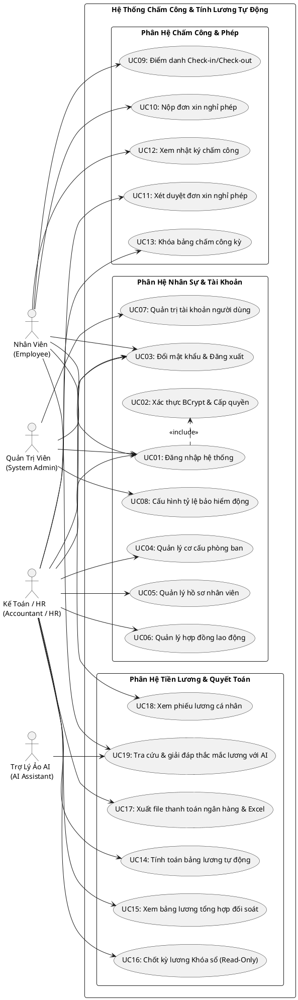

# BỘ GIÁO DỤC VÀ ĐÀO TẠO - ĐẠI HỌC HUẾ
## TRƯỜNG ĐẠI HỌC KINH TẾ
### KHOA HỆ THỐNG THÔNG TIN KINH TẾ

---

# BÁO CÁO ĐỒ ÁN HỌC PHẦN
## HỌC PHẦN: LẬP TRÌNH ỨNG DỤNG WEB

### ĐỀ TÀI:
# XÂY DỰNG HỆ THỐNG ỨNG DỤNG WEB CHẤM CÔNG VÀ TÍNH LƯƠNG TỰ ĐỘNG (TIMESHEET & PAYROLL AUTOMATION SYSTEM)

---

- **Giảng viên hướng dẫn:** TS. Hà Ngọc Long
- **Sinh viên thực hiện:** Trần Viết Mạnh Cường
- **Mã sinh viên:** 23K4080003
- **Lớp sinh hoạt:** K57 Tin học kinh tế
- **Khóa học:** 2023 – 2027
- **Kho lưu trữ (Repository):** https://github.com/ManhCuong-Code/TimesheetPayroll.git

*Thành phố Huế, năm 2026*

---

\newpage

## LỜI CẢM ƠN

Trong quá trình học tập, nghiên cứu và hoàn thành đồ án môn học **Lập trình ứng dụng web**, em đã nhận được sự quan tâm, chỉ dẫn tận tình từ quý Thầy, Cô giáo trong Khoa Hệ thống Thông tin Kinh tế – Trường Đại học Kinh tế, Đại học Huế.

Trước hết, em xin bày tỏ lòng biết ơn sâu sắc và chân thành nhất tới **Thầy TS. Hà Ngọc Long** – Giảng viên trực tiếp phụ trách và giảng dạy học phần Lập trình ứng dụng web. Trong suốt thời gian qua, Thầy đã tận tâm truyền đạt những kiến thức nền tảng và chuyên sâu về kiến trúc ứng dụng web hiện đại, phương pháp thiết kế phần mềm theo kiến trúc sạch (Clean Architecture), nguyên lý phân quyền bảo mật và định hướng giải quyết các bài toán nghiệp vụ doanh nghiệp thực tế. Sự khích lệ, tận tình và những nhận xét học thuật quý báu của Thầy là động lực to lớn giúp em hoàn thành tốt đồ án này.

Em cũng xin gửi lời cảm ơn trân trọng tới toàn thể quý Thầy, Cô giáo Khoa Hệ thống Thông tin Kinh tế đã trang bị cho em hành trang kiến thức vững chắc về cơ sở dữ liệu quan hệ, phân tích thiết kế hệ thống và kỹ thuật lập trình trong các kỳ học vừa qua.

Mặc dù em đã nỗ lực vận dụng tối đa các kiến thức đã học cùng tinh thần làm việc nghiêm túc, nhưng do thời gian và kinh nghiệm thực tế còn hạn chế nên bản báo cáo khó tránh khỏi những thiếu sót nhất định. Em rất kính mong nhận được những lời chỉ dẫn, nhận xét và đóng góp quý báu từ Thầy TS. Hà Ngọc Long để đồ án được hoàn thiện hơn nữa và làm nền tảng vững chắc cho quá trình học tập, nghiên cứu chuyên sâu trong tương lai.

*Em xin kính chúc Thầy dồi dào sức khỏe, hạnh phúc và gặt hái được nhiều thành công hơn nữa trong sự nghiệp giảng dạy và nghiên cứu khoa học!*

\begin{flushright}
*Huế, tháng 01 năm 2026*  
**Sinh viên thực hiện**  
*Trần Viết Mạnh Cường*
\end{flushright}

---

\newpage

## MỤC LỤC TỔNG QUAN

- **LỜI CẢM ƠN**
- **DANH MỤC THUẬT NGỮ VÀ KÝ HIỆU VIẾT TẮT**
- **DANH MỤC BẢNG BIỂU VÀ HÌNH ẢNH**
- **LỜI MỞ ĐẦU**
- **CHƯƠNG 1: TỔNG QUAN VỀ BÀI TOÁN VÀ KHẢO SÁT NGHIỆP VỤ DOANH NGHIỆP**
  - 1.1. Bối cảnh và thực trạng quản lý nhân sự, chấm công tại các doanh nghiệp
  - 1.2. Những thách thức và rủi ro của phương pháp quản lý thủ công bằng bảng tính Excel
  - 1.3. Mục tiêu và phạm vi xây dựng hệ thống ứng dụng Web
  - 1.4. Đối tượng sử dụng và ma trận phân quyền hệ thống (RBAC)
- **CHƯƠNG 2: PHÂN TÍCH VÀ THIẾT KẾ HỆ THỐNG ỨNG DỤNG WEB**
  - 2.1. Phân tích yêu cầu chức năng (Functional Requirements)
  - 2.2. Phân tích yêu cầu phi chức năng (Non-Functional Requirements)
  - 2.3. Mô hình hóa chức năng bằng hệ thống sơ đồ Use Case (PlantUML)
  - 2.4. Thiết kế cơ sở dữ liệu quan hệ chuẩn 3NF (11 bảng thực thể cốt lõi)
  - 2.5. Ràng buộc toàn vẹn, Khóa ngoại và Toàn vẹn giao dịch ACID (Header-Line)
- **CHƯƠNG 3: THIẾT KẾ KIẾN TRÚC VÀ GIAO DIỆN ỨNG DỤNG WEB (UI/UX)**
  - 3.1. Lựa chọn mô hình kiến trúc sạch (Clean Architecture 4 tầng)
  - 3.2. Cấu trúc tổ chức thư mục giải pháp và ngăn xếp công nghệ (.NET 10, Blazor Server, Dapper, SQL Server)
  - 3.3. Thiết kế luồng điều hướng và sơ đồ trang (Site Map & Navigation)
  - 3.4. Thiết kế chi tiết giao diện người dùng các phân hệ chính
  - 3.5. Thiết kế đáp ứng đa thiết bị (Responsive Mobile UI 390px)
- **CHƯƠNG 4: HIỆN THỰC HÓA VÀ CÀI ĐẶT CÁC PHÂN HỆ NGHIỆP VỤ**
  - 4.1. Hiện thực hóa cơ chế Xác thực & Phân quyền đa vai trò (RBAC, BCrypt & Phòng vệ chống Bypass URL)
  - 4.2. Hiện thực hóa Luật nghiệp vụ 1: Động cơ tính lương chuẩn theo Luật Lao Động & Tỷ lệ trích nộp động
  - 4.3. Hiện thực hóa Luật nghiệp vụ 2: Khóa sổ kỳ lương Read-Only & Bảo vệ chống lỗ hổng IDOR
  - 4.4. Hiện thực hóa Phân hệ Chấm công, Quản lý Ca làm việc và Duyệt đơn nghỉ phép
  - 4.5. Hiện thực hóa Phân hệ Tính lương 1-chạm (1-Click Run) trong Database Transaction
  - 4.6. Tính năng nâng cao: Trợ lý Lương AI thông minh (Gemini API & Fallback Engine)
  - 4.7. Tính năng nâng cao: Xuất báo cáo bảng lương Excel Mẫu số 02-LĐTL và CSV ngân hàng
- **CHƯƠNG 5: KIỂM THỬ HỆ THỐNG VÀ ĐÁNH GIÁ KẾT QUẢ**
  - 5.1. Môi trường và phương pháp kiểm thử
  - 5.2. Kịch bản kiểm thử chức năng then chốt (10 Test Cases TC01 – TC10)
  - 5.3. Kiểm thử an toàn bảo mật, chống lỗi IDOR và chống tiêm mã độc SQL Injection
  - 5.4. Đánh giá kết quả đạt được và hiệu năng hệ thống
- **KẾT LUẬN VÀ HƯỚNG PHÁT TRIỂN**
- **TÀI LIỆU THAM KHẢO**

---

\newpage

## DANH MỤC THUẬT NGỮ VÀ KÝ HIỆU VIẾT TẮT

| Viết tắt | Tên tiếng Anh đầy đủ | Diễn giải ý nghĩa |
| :--- | :--- | :--- |
| **HRMS** | Human Resource Management System | Hệ thống quản lý nguồn nhân lực doanh nghiệp |
| **CSDL** | Cơ Sở Dữ Liệu | Database – Kho dữ liệu quan hệ có cấu trúc |
| **3NF** | Third Normal Form | Dạng chuẩn 3 trong thiết kế cơ sở dữ liệu quan hệ |
| **RBAC** | Role-Based Access Control | Cơ chế kiểm soát truy cập phân quyền dựa trên vai trò |
| **IDOR** | Insecure Direct Object References | Lỗ hổng bảo mật tham chiếu đối tượng trực tiếp không an toàn |
| **ACID** | Atomicity, Consistency, Isolation, Durability | 4 thuộc tính đảm bảo an toàn tuyệt đối của một giao dịch CSDL |
| **ORM** | Object-Relational Mapping | Kỹ thuật ánh xạ giữa đối tượng lập trình và CSDL quan hệ |
| **DI** | Dependency Injection | Kỹ thuật tiêm phụ thuộc giúp mã nguồn độc lập, linh hoạt |
| **SPA** | Single Page Application | Ứng dụng web trang đơn tương tác thời gian thực |
| **BHXH** | Bảo hiểm Xã hội | Khoản trích nộp an sinh xã hội bắt buộc (8.0% người lao động) |
| **BHYT** | Bảo hiểm Y tế | Khoản trích nộp bảo hiểm y tế bắt buộc (1.5% người lao động) |
| **BHTN** | Bảo hiểm Thất nghiệp | Khoản trích nộp bảo hiểm thất nghiệp (1.0% người lao động) |
| **TNCN** | Thu nhập cá nhân | Thuế thu nhập cá nhân tính theo biểu thuế lũy tiến từng phần |
| **AI** | Artificial Intelligence | Trí tuệ nhân tạo (Mô hình ngôn ngữ lớn LLM - Google Gemini) |

---

\newpage

## LỜI MỞ ĐẦU

Trong nền kinh tế hiện đại, nguồn nhân lực là tài sản quý giá nhất quyết định sự phát triển bền vững của mọi tổ chức và doanh nghiệp. Đi đôi với việc quản lý nhân sự, công tác theo dõi ngày công (Timesheet) và tính toán chi trả tiền lương (Payroll) hàng tháng là một nghiệp vụ tài chính trọng yếu, tác động trực tiếp đến quyền lợi thiết thân của người lao động cũng như sự tuân thủ pháp lý của doanh nghiệp trước các quy định của Luật Lao Động và Luật Bảo Hiểm Xã Hội.

Tuy nhiên, tại phần lớn các doanh nghiệp vừa và nhỏ hiện nay, công tác chấm công và tính lương vẫn chủ yếu được thực hiện một cách thủ công thông qua các bảng tính Excel rời rạc. Phương thức này bộc lộ rất nhiều hạn chế nghiêm trọng: kế toán mất hàng ngày trời để đối soát từng dòng công; công thức dễ bị sai sót khi kéo lệch ô; rủi ro lộ bí mật thông tin thu nhập khi gửi chung file tính; và đặc biệt là sự thiếu linh hoạt khi các chính sách bảo hiểm, mức lương cơ sở hay quy định thuế TNCN của Nhà nước thay đổi.

Trước bối cảnh đó, việc xây dựng một **Hệ Thống Ứng Dụng Web Chấm Công & Tính Lương Tự Động (Timesheet & Payroll Automation System)** độc lập, hiện đại, an toàn và dễ sử dụng là một đòi hỏi cấp thiết. Hệ thống không chỉ giải phóng kế toán khỏi khối lượng công việc tính toán thủ công nặng nhọc, mà còn đảm bảo tính minh bạch, chính xác tuyệt đối, hỗ trợ nhân viên tự phục vụ và ứng dụng Trí tuệ Nhân tạo (AI) để giải đáp thắc mắc lương tức thì.

Dưới sự chỉ dẫn tận tình của **Thầy TS. Hà Ngọc Long**, em đã lựa chọn và hoàn thiện đề tài: **"Xây dựng hệ thống ứng dụng Web chấm công và tính lương tự động (Timesheet & Payroll Automation System)"** cho đồ án môn học **Lập trình ứng dụng web**. Đề tài được thiết kế theo mô hình kiến trúc sạch **Clean Architecture**, công nghệ **.NET 10 Blazor Interactive Server**, kết nối cơ sở dữ liệu **Microsoft SQL Server (`BangChamCongDB`)** qua **Dapper Micro-ORM**, mang lại một giải pháp phần mềm hoàn chỉnh, an toàn và đạt chuẩn công nghiệp.

---

\newpage

# CHƯƠNG 1: TỔNG QUAN VỀ BÀI TOÁN VÀ KHẢO SÁT NGHIỆP VỤ DOANH NGHIỆP

## 1.1. Bối cảnh và thực trạng quản lý nhân sự, chấm công tại các doanh nghiệp
Trong chu trình vận hành của bất kỳ doanh nghiệp nào, quy trình từ chấm công đến tính lương diễn ra định kỳ theo tháng với các hoạt động cốt lõi:
1. **Thiết lập cơ cấu tổ chức & hồ sơ:** Quản lý danh mục phòng ban, danh sách nhân viên, thông tin tài khoản ngân hàng và ký kết hợp đồng lao động quy định mức lương cơ bản, phụ cấp ăn trưa, xăng xe.
2. **Ghi nhận ngày công:** Nhân viên thực hiện điểm danh Check-in/Check-out theo các ca làm việc; nộp đơn xin nghỉ phép khi có việc riêng hoặc ốm đau.
3. **Đối soát & Khóa bảng công:** Cuối kỳ, bộ phận quản lý/kế toán tổng hợp tổng số ngày công làm việc thực tế, ngày nghỉ có phép, ngày nghỉ không lương và chốt bảng công tháng.
4. **Tính lương & Quyết toán tài chính:** Áp dụng công thức lương theo tỷ lệ ngày công, cộng các khoản phụ cấp, tính thưởng, phạt, trích nộp các khoản bảo hiểm bắt buộc (BHXH 8%, BHYT 1.5%, BHTN 1%), tính thuế TNCN và xác định số tiền thực lĩnh (Net Salary).
5. **Chi trả & Bảo lưu hồ sơ:** Xuất bảng lương chi tiết gửi nhân viên, xuất danh sách chuyển khoản ngân hàng và lưu trữ hồ sơ tài chính phục vụ quyết toán thuế.

## 1.2. Những thách thức và rủi ro của phương pháp quản lý thủ công bằng bảng tính Excel
Khảo sát thực tế cho thấy các doanh nghiệp quản lý lương bằng Excel gặp phải 4 nguy cơ thường trực:
1. **Rủi ro sai lệch công thức:** Kế toán chỉ cần kéo nhầm một hàng dữ liệu hoặc sai lệch dấu ngoặc đơn là lương của hàng chục nhân viên bị tính thiếu hoặc thừa hàng triệu đồng, dẫn đến tranh chấp, khiếu nại.
2. **Tiêu tốn nguồn lực và thời gian:** Kế toán phải mất từ 2 đến 3 ngày mỗi cuối tháng để đối soát từng tờ phiếu chấm công, kiểm tra đơn xin nghỉ phép giấy và dò tìm tỷ lệ bảo hiểm.
3. **Lộ bí mật thu nhập nội bộ (Data Privacy):** Chia sẻ chung một file Excel bảng lương rất dễ khiến nhân viên dòm ngó mức thu nhập của đồng nghiệp, gây mất đoàn kết nội bộ và vi phạm nghiêm trọng chính sách bảo mật thông tin.
4. **Không đáp ứng được sự thay đổi của luật pháp:** Mức lương cơ sở, tỷ lệ trích nộp BHXH/BHYT/BHTN hay mức giảm trừ gia cảnh thuế TNCN thường xuyên được điều chỉnh theo Nghị định của Chính phủ. Nếu bị hardcode cứng trong bảng tính, kế toán rất khó cập nhật đồng bộ.

## 1.3. Mục tiêu và phạm vi xây dựng hệ thống ứng dụng Web
- **Mục tiêu tổng quát:** Xây dựng một ứng dụng web hoàn chỉnh phục vụ tự động hóa toàn diện quy trình chấm công, quản lý nghỉ phép và tính lương doanh nghiệp, đảm bảo chuẩn xác 100%, bảo mật dữ liệu và tuân thủ chặt chẽ Luật Lao Động Việt Nam.
- **Mục tiêu kỹ thuật:**
  - Áp dụng kiến trúc sạch **Clean Architecture 4 tầng** (.NET 10 Blazor Interactive Server), phân tách rành mạch trách nhiệm giữa các tầng, tuân thủ nguyên lý Dependency Rule.
  - Thiết kế cơ sở dữ liệu quan hệ chuẩn hóa **3NF** trên Microsoft SQL Server với 11 bảng thực thể.
  - Bảo mật tài khoản bằng giải thuật băm một chiều **BCrypt**, phân quyền đa vai trò **RBAC** và phòng vệ đa tầng chống lỗ hổng **IDOR** và **Bypass URL**.
  - Tự động hóa tính lương 1-chạm (1-Click Run) trong một **Database Transaction** an toàn tuyệt đối.
  - Tích hợp **Trợ lý AI** giải đáp thắc mắc lương và tính năng xuất báo cáo **Excel Mẫu số 02-LĐTL** của Bộ Tài chính.
  - Giao diện người dùng hiện đại, tương thích hoàn hảo trên thiết bị di động (kiểm thử chuẩn 390px chiều ngang).

## 1.4. Đối tượng sử dụng và ma trận phân quyền hệ thống (RBAC)
Hệ thống phân định rạch ròi 3 nhóm vai trò (Roles) trong bảng `user_accounts`:

| Mã Vai Trò | Tên Vai Trò | Quyền Hạn Nghiệp Vụ Cốt Lõi |
| :---: | :--- | :--- |
| **`ROLE_EMPLOYEE`** | **Nhân Viên** | • Điểm danh Check-in / Check-out hàng ngày.<br>• Xem nhật ký bảng công tháng của cá nhân.<br>• Nộp đơn xin nghỉ phép trực tuyến.<br>• Xem chi tiết phiếu lương của chính mình (chống xem lén của người khác).<br>• Tương tác cùng Trợ lý Lương AI hỏi đáp chế độ và mô phỏng What-If.<br>• Đổi mật khẩu tài khoản cá nhân. |
| **`ROLE_HR_ACCOUNTANT`** | **Kế Toán / Nhân Sự** | • Toàn bộ quyền của Nhân viên.<br>• Xét duyệt hoặc từ chối các đơn xin nghỉ phép của nhân viên.<br>• Khóa sổ bảng chấm công tháng.<br>• Thực thi tính toán bảng lương tự động hàng loạt 1-chạm.<br>• Xem bảng tổng hợp quỹ lương toàn công ty để đối soát.<br>• Chốt khóa sổ kỳ lương (trạng thái `LOCKED` - Read-Only) chống chỉnh sửa.<br>• Xuất báo cáo bảng lương Excel Mẫu số 02-LĐTL và file CSV ngân hàng.<br>• Quản lý danh mục ca làm việc (`/admin/shifts`). |
| **`ROLE_ADMIN`** | **Quản Trị Viên** | • Toàn quyền tối cao quản trị toàn bộ hệ thống.<br>• Quản lý tài khoản người dùng, tạo mới và cấp quyền vai trò (`/admin/users`).<br>• Cấu hình các tỷ lệ trích nộp bảo hiểm động (BHXH, BHYT, BHTN).<br>• Quản lý phòng ban, hợp đồng và nhân sự.<br>• Giám sát toàn bộ tiến trình tính lương và chốt sổ tài chính. |

---

\newpage

# CHƯƠNG 2: PHÂN TÍCH VÀ THIẾT KẾ HỆ THỐNG ỨNG DỤNG WEB

## 2.1. Phân tích yêu cầu chức năng (Functional Requirements)
Hệ thống được thiết kế xoay quanh 5 phân hệ nghiệp vụ thống nhất:
1. **Phân hệ 1: Quản trị Xác thực & Tài khoản người dùng (UC01 – UC03):** Đăng nhập an toàn bằng mật khẩu băm BCrypt; đổi mật khẩu; quản lý tài khoản và phân quyền vai trò.
2. **Phân hệ 2: Quản trị Cơ cấu Tổ chức & Nhân sự (UC04 – UC08):** Quản lý danh mục phòng ban; quản lý hồ sơ nhân viên (số CCCD, số tài khoản ngân hàng); quản lý hợp đồng lao động; cấu hình tỷ lệ trích nộp bảo hiểm động.
3. **Phân hệ 3: Quản lý Chấm công & Nghỉ phép (UC09 – UC13):** Điểm danh Check-in/Check-out theo ca làm việc; nộp đơn xin nghỉ phép; xét duyệt đơn nghỉ phép; khóa sổ bảng chấm công tháng.
4. **Phân hệ 4: Động cơ Tính lương Tự động & Quyết toán (UC14 – UC17):** Chạy tính toán lương hàng loạt; đối soát quỹ lương; chốt kỳ lương Read-Only; xuất báo cáo thanh toán ngân hàng và Excel.
5. **Phân hệ 5: Cổng Tự phục vụ Nhân viên & Trợ lý AI (UC18 – UC19):** Tra cứu phiếu lương cá nhân an toàn (chống IDOR); hỏi đáp quy chế lương với Trợ lý AI; mô phỏng lương What-If.

## 2.2. Phân tích yêu cầu phi chức năng (Non-Functional Requirements)
1. **Bảo mật và Quyền riêng tư (Security & Privacy):**
   - 100% mật khẩu được băm một chiều bằng BCrypt với Salt ngẫu nhiên và WorkFactor = 11.
   - 100% câu truy vấn CSDL được tham số hóa thông qua Dapper Micro-ORM, triệt tiêu nguy cơ SQL Injection.
   - Phòng vệ đa tầng (Defense in Depth): Chặn tài khoản thường gõ thẳng URL quản trị bằng `AuthorizeRouteView` (HTTP 403 Forbidden).
   - Bảo mật cấp bản ghi (Anti-IDOR): Nhân viên chỉ xem được phiếu lương có `EmployeeId` trùng khớp với Claim định danh từ phiên đăng nhập.
2. **Toàn vẹn dữ liệu & Tính nhất quán (Data Integrity & ACID):**
   - Nghiệp vụ ghi nhận bảng lương (Header `payslips` và Line `payslip_lines`) bắt buộc thực thi trong một `Database Transaction`. Nếu có lỗi, hệ thống Rollback 100%.
   - Kỳ lương ở trạng thái `LOCKED` (Khóa sổ) hoặc `PAID` (Đã thanh toán) tuyệt đối không cho phép tính lại để bảo toàn tính bất biến của số liệu kế toán.
3. **Khả năng đáp ứng đa thiết bị (Responsive Mobile 390px):**
   - Tương thích tối ưu từ màn hình Desktop (1920x1080) đến màn hình điện thoại di động hẹp (390px). Menu tự động thu gọn hamburger, bảng dữ liệu hỗ trợ vuốt cuộn ngang mượt mà.

## 2.3. Mô hình hóa chức năng bằng sơ đồ Use Case (PlantUML)
Hệ thống được chuẩn hóa mô hình hóa với sơ đồ Use Case tổng quan và các sơ đồ phân rã phân hệ:



## 2.4. Thiết kế cơ sở dữ liệu quan hệ chuẩn 3NF (11 bảng thực thể cốt lõi)
Hệ thống sử dụng cơ sở dữ liệu `BangChamCongDB` trên Microsoft SQL Server với 11 bảng thực thể được chuẩn hóa đạt chuẩn 3NF:

1. **`departments` (Phòng ban):** `id`, `department_code` (UNIQUE), `department_name`, `manager_name`, `created_at`.
2. **`employees` (Hồ sơ nhân viên):** `id`, `employee_code` (UNIQUE), `full_name`, `date_of_birth`, `gender`, `identity_card_number` (CCCD UNIQUE), `email` (UNIQUE), `bank_account_number`, `bank_name`, `department_id` (FK), `hire_date`, `status`.
3. **`user_accounts` (Tài khoản người dùng):** `id`, `employee_id` (FK UNIQUE 1-1), `username` (UNIQUE), `password_hash` (BCrypt), `role` (`ROLE_EMPLOYEE`, `ROLE_HR_ACCOUNTANT`, `ROLE_ADMIN`), `is_active`.
4. **`contracts` (Hợp đồng lao động):** `id`, `employee_id` (FK), `contract_number` (UNIQUE), `contract_type`, `base_salary` (>= 0), `meal_allowance`, `fuel_allowance`, `start_date`, `end_date`, `is_active`.
5. **`payroll_periods` (Kỳ lương):** `id`, `period_code` (UNIQUE), `period_month` (1-12), `period_year`, `standard_working_days` (chuẩn 22-26), `status` (`DRAFT`, `CALCULATING`, `CALCULATED`, `LOCKED`, `PAID`), `is_locked`, `total_gross_amount`, `total_net_amount`.
6. **`deduction_rates` (Tỷ lệ trích nộp bảo hiểm động):** `id`, `rate_code` (UNIQUE: `BHXH_EMP`, `BHYT_EMP`, `BHTN_EMP`), `rate_name`, `percentage` (0.08, 0.015, 0.01), `is_active`, `effective_date`.
7. **`work_shifts` (Danh mục ca làm việc):** `id`, `shift_code` (UNIQUE), `shift_name`, `start_time`, `end_time`, `working_hours`, `overtime_rate`.
8. **`timesheets` (Bảng chấm công chi tiết):** `id`, `employee_id` (FK), `period_id` (FK), `work_date`, `work_shift_id` (FK), `check_in_time`, `check_out_time`, `working_days_counted`, `overtime_hours`, `attendance_status`.
9. **`leave_requests` (Đơn xin nghỉ phép):** `id`, `employee_id` (FK), `leave_type` (`ANNUAL`, `SICK`, `UNPAID`), `start_date`, `end_date`, `number_of_days`, `reason`, `status` (`PENDING`, `APPROVED`, `REJECTED`), `approver_id` (FK).
10. **`payslips` (Phiếu lương tổng hợp - Header):** `id`, `period_id` (FK), `employee_id` (FK), `actual_working_days`, `prorated_base_salary`, `total_allowance`, `gross_salary`, `total_deductions`, `taxable_income`, `personal_income_tax`, `net_salary`, `payment_status`.
11. **`payslip_lines` (Chi tiết các dòng lương/khấu trừ - Line):** `id`, `payslip_id` (FK ON DELETE CASCADE), `line_code` (`BASE_SALARY`, `MEAL_ALLOWANCE`, `BHXH_8%`, `BHYT_1.5%`, `BHTN_1%`, `PIT`), `line_name`, `amount`, `line_type` (`EARNING`, `DEDUCTION`, `TAX`).

## 2.5. Ràng buộc toàn vẹn, Khóa ngoại và Toàn vẹn giao dịch ACID
- **Ràng buộc kiểm tra (CHECK Constraints):**
  - `chk_contract_salary`: Mức lương cơ bản không âm: `CHECK (base_salary >= 0)`.
  - `chk_contract_dates`: Ngày kết thúc hợp đồng phải sau ngày bắt đầu: `CHECK (end_date IS NULL OR end_date >= start_date)`.
  - `chk_period_month`: Tháng kỳ lương hợp lệ từ 1 đến 12: `CHECK (period_month BETWEEN 1 AND 12)`.
  - `chk_period_status`: Trạng thái kỳ lương chỉ thuộc tập: `CHECK (status IN ('DRAFT', 'CALCULATING', 'CALCULATED', 'LOCKED', 'PAID'))`.
- **Toàn vẹn giao dịch Cặp Header-Line (`payslips` – `payslip_lines`):**
  Khi chạy tính lương hàng loạt, toàn bộ phiếu lương và các dòng chi tiết được lưu trong một Transaction với `using var tx = conn.BeginTransaction()`. Nếu xảy ra bất kỳ lỗi dữ liệu nào, hệ thống lập tức thực hiện `tx.Rollback()`, bảo đảm dữ liệu kế toán luôn toàn vẹn và nhất quán.

## 2.6. Cơ chế giao tiếp cơ sở dữ liệu hai chiều (Bidirectional Database Communication)
Nhằm khắc phục triệt để nhược điểm của các hệ thống web tĩnh chỉ hiển thị dữ liệu mẫu một chiều (Display-Only), hệ thống đã thiết kế và hiện thực hóa cơ chế **Giao tiếp cơ sở dữ liệu hai chiều (Bidirectional Read & Write Communication)** toàn diện:

1. **Chiều Ghi (Write / Command Flow - Web $\longrightarrow$ CSDL):**
   - Mọi thao tác nghiệp vụ phát sinh từ phía người dùng trên giao diện web đều được kiểm chứng hợp lệ (Validation) và gửi lệnh trực tiếp xuống CSDL Microsoft SQL Server (`BangChamCongDB`):
     - *Nhân viên điểm danh khuôn mặt:* Gửi `POST /api/bang-cham-cong/diem-danh` $\rightarrow$ ghi nhận thời gian thực vào bảng `timesheets`.
     - *Nhân viên nộp đơn nghỉ phép:* Gửi `POST /api/don-phep/tao-don` $\rightarrow$ ghi bản ghi mới vào bảng `leave_requests` (trạng thái `PENDING`).
     - *Quản lý / Nhân sự xét duyệt đơn:* Gửi `PUT /api/don-phep/{id}/phe-duyet` $\rightarrow$ cập nhật trạng thái `APPROVED` / `REJECTED` vào bảng `leave_requests`, đồng thời tự động cập nhật ngày công tương ứng trong bảng `timesheets`.
     - *Kế toán chạy tính lương:* Gửi `POST /api/tinh-luong/chay-tu-dong` $\rightarrow$ thực thi giao dịch ACID lưu 20 phiếu lương và toàn bộ dòng chi tiết vào các bảng `payslips` và `payslip_lines`.
     - *Chốt khóa sổ kỳ lương:* Gửi `POST /api/tinh-luong/chot-ky-khoa-so/{id}` $\rightarrow$ chuyển trạng thái kỳ lương sang `LOCKED` (Read-Only) và khóa bảng chấm công.

2. **Chiều Đọc & Phản Hồi Thời Gian Thực (Read & Reflection Flow - CSDL $\longrightarrow$ Web):**
   - Khi dữ liệu trong CSDL được ghi hoặc cập nhật, hệ thống lập tức phản hồi và cập nhật số liệu hiển thị trên các màn hình liên quan mà không cần tải lại trang (Zero Reload):
     - Kế toán vừa duyệt đơn nghỉ phép của nhân viên $\rightarrow$ màn hình của nhân viên lập tức chuyển màu xanh "Đã duyệt" và số ngày công trong lịch công tự động cộng thêm ngày phép có lương.
     - Kế toán chạy tính lương $\rightarrow$ các thẻ KPI quỹ lương toàn công ty nhảy số tức thì, và cổng tra cứu của nhân viên mở khóa phiếu lương chi tiết của tháng đó.
   - Cơ chế này được hỗ trợ đồng thời qua 2 kênh:
     - Kênh truyền thời gian thực **SignalR WebSocket** trên nền tảng Blazor Interactive Server.
     - Kênh truyền **Bidirectional Reactive Engine (`database_sync.js`)** tích hợp `BroadcastChannel` và `StorageEvent` liên tab, đảm bảo trải nghiệm tương tác 2 chiều mượt mà kể cả khi trình diễn từ xa.

---

\newpage

# CHƯƠNG 3: THIẾT KẾ KIẾN TRÚC VÀ GIAO DIỆN ỨNG DỤNG WEB (UI/UX)

## 3.1. Lựa chọn mô hình kiến trúc sạch (Clean Architecture 4 tầng)
Hệ thống được tổ chức theo chuẩn kiến trúc sạch (Clean Architecture) đề xuất bởi Robert C. Martin, phân chia mã nguồn thành 4 tầng rành mạch:

```
[ TẦNG 1: PRESENTATION LAYER (WEB & UI) ]
  • TimesheetPayroll.Web (.NET 10 Blazor Interactive Server)
  • TopNavbar, MainLayout, Routes.razor
  • Web.AdminPortal & Web.EmployeePortal Pages
  • Responsive CSS 390px, Bootstrap 5.3, FontAwesome 6
           |
           v (Chỉ phụ thuộc Use Cases Interfaces)
[ TẦNG 2: APPLICATION & USE CASES LAYER ]
  • TimesheetPayroll.UseCases
  • Use Cases: CalculatePayrollBatchUseCase, ExportPayrollExcelUseCase,
    SalaryAiUseCases, LeaveRequestUseCases, LoginUseCase...
  • PluginInterfaces: IEmployeeRepository, IPayslipRepository...
           |
           v (Chỉ phụ thuộc Core Business)
[ TẦNG 3: CORE DOMAIN LAYER (TRUNG TÂM MIỀN) ]
  • TimesheetPayroll.CoreBusiness (0 Project Reference)
  • Entities: Employee, Department, Contract, Timesheet, Payslip, Period...
  • Business Engines: SalaryFormulaEngine, VietnameseLaborRegulations...
           ^
           | (Triển khai các Interface Repository)
[ TẦNG 4: PLUGINS & INFRASTRUCTURE LAYER ]
  • TimesheetPayroll.DataStore.SQL.Dapper (Dapper Micro-ORM)
  • TimesheetPayroll.StateStore.DI (Scoped State Store)
  • Microsoft SQL Server Database (BangChamCongDB)
```

**Quy tắc phụ thuộc (Dependency Rule):**
- Tầng `CoreBusiness` nằm ở vị trí trung tâm, không phụ thuộc vào bất kỳ tầng nào khác.
- Tầng `UseCases` chỉ phụ thuộc duy nhất vào `CoreBusiness`.
- Tầng `Plugins` (DataStore) và `Web` nằm ở vòng ngoài cùng, phụ thuộc vào các `Interface` được định nghĩa ở `UseCases`.

## 3.2. Cấu trúc tổ chức thư mục giải pháp và ngăn xếp công nghệ
Giải pháp bao gồm 4 project chính:
1. `TimesheetPayroll.CoreBusiness`: Chứa các thực thể miền và động cơ công thức tính lương độc lập (`SalaryFormulaEngine.cs`).
2. `TimesheetPayroll.UseCases`: Chứa các ca sử dụng nghiệp vụ và các interface trừu tượng (`IRepositories.cs`).
3. `TimesheetPayroll.DataStore.SQL.Dapper`: Plugin triển khai truy xuất dữ liệu SQL Server bằng Dapper Micro-ORM với 100% truy vấn tham số hóa.
4. `TimesheetPayroll.Web`: Project khởi chạy (Composition Root) cấu hình Dependency Injection, tích hợp Blazor Interactive Server, SignalR thời gian thực và quản trị xác thực.

## 3.3. Thiết kế luồng điều hướng và sơ đồ trang (Site Map & Navigation)
- `/login`: Màn hình Đăng nhập xác thực BCrypt, hỗ trợ nút Quick Login Demo 1-chạm.
- `/`: Trang Tổng quan (Dashboard) hiển thị các chỉ số KPI nhân sự, ngày công và bảng lương.
- `/admin/payroll-calculation`: Phân hệ Kế toán chạy Tính lương hàng loạt, Xem bảng lương tổng hợp đối soát, Chốt khóa sổ kỳ lương (`LOCKED`) và Xuất báo cáo.
- `/admin/shifts`: Phân hệ Quản trị danh mục ca làm việc và hệ số làm thêm giờ.
- `/admin/users`: Phân hệ Quản trị tài khoản người dùng và phân quyền vai trò.
- `/my-timesheet`: Phân hệ Nhân viên điểm danh Check-in/Check-out và tra cứu bảng công.
- `/leave-request`: Phân hệ Nhân viên nộp đơn xin nghỉ phép có kiểm tra validation ngày tháng.
- `/my-payslip`: Phân hệ Tra cứu phiếu lương cá nhân an toàn (bảo vệ chống IDOR).
- `/ai-salary-assistant`: Phân hệ Trợ lý Lương AI hỏi đáp chế độ và mô phỏng What-If.
- `/change-password`: Màn hình đổi mật khẩu cá nhân.

## 3.4. Thiết kế chi tiết giao diện người dùng các phân hệ chính
- **Dashboard Tổng quan:** 4 thẻ Card chỉ số KPI nổi bật (Tổng Nhân sự, Giờ công tích lũy, Quỹ lương tháng, Trạng thái kỳ lương), kèm biểu đồ phân bổ cơ cấu chi phí.
- **Trang Tính Lương Hàng Loạt:** Nút hành động nổi bật "Chạy Tính Lương Tự Động 1-Chạm", bảng tổng hợp đối soát chi tiết từng nhân viên (Lương CB, Ngày công, Phụ cấp, Giảm trừ BHXH, Thuế TNCN, Thực lĩnh), nút "Khóa Sổ Kỳ Lương" và nút "Xuất Excel Mẫu 02-LĐTL".
- **Widget Trợ Lý Lương AI Nổi Toàn Hệ Thống (`FloatingAiAssistant.razor`):** Nút tròn AI nổi góc phải dưới màn hình ở mọi trang, bấm vào mở khung chat kính mờ hiện đại giải đáp thắc mắc lương tức thì.

## 3.5. Thiết kế đáp ứng đa thiết bị (Responsive Mobile UI 390px)
- Kiểm thử chuẩn mực trên DevTools độ phân giải bề ngang hẹp 390px (chuẩn iPhone 12/14/15/16).
- Thanh menu tự động thu gọn vào nút Hamburger co giãn mượt mà.
- Bảng dữ liệu được bọc trong lớp `.table-responsive` hỗ trợ vuốt chạm cảm ứng mượt mà.
- Widget AI tự động co giãn kích thước `calc(100vw - 20px)` vừa vặn toàn màn hình di động mà không gây tràn viền.

---

\newpage

# CHƯƠNG 4: HIỆN THỰC HÓA VÀ CÀI ĐẶT CÁC PHÂN HỆ NGHIỆP VỤ

## 4.1. Hiện thực hóa cơ chế Xác thực & Phân quyền đa vai trò (RBAC, BCrypt & Phòng vệ URL)
Hệ thống cài đặt `CustomAuthenticationStateProvider` tích hợp `BCrypt.Net-Next`:
- Khi đăng nhập, mật khẩu được kiểm chứng qua `BCrypt.Verify(rawPassword, hash)`.
- Khi hợp lệ, Claims được khởi tạo gồm `Name`, `Role` và `EmployeeId`.
- **Phòng vệ chống vượt quyền URL (Defense in Depth):**
  - Tại tầng Router (`Routes.razor`): Sử dụng `<AuthorizeRouteView>`. Khi người dùng tài khoản thường gõ trực tiếp URL quản trị trên thanh địa chỉ, Router lập tức chặn và hiển thị màn hình cảnh báo **HTTP 403 Forbidden**.
  - Tại tầng Component: Khai báo `@attribute [Authorize(Roles = "ROLE_HR_ACCOUNTANT, ROLE_ADMIN")]` bảo vệ trang.

## 4.2. Hiện thực hóa Luật nghiệp vụ 1: Động cơ tính lương chuẩn theo Luật Lao Động & Tỷ lệ trích nộp động
Cài đặt tại `SalaryFormulaEngine.cs` trong project `CoreBusiness`:
1. **Lương ngày công theo tỷ lệ:**
   $$\text{Lương ngày công} = \text{Lương cơ bản} \times \frac{\text{Ngày công thực tế}}{\text{Ngày công chuẩn}}$$
2. **Tổng thu nhập gộp (Gross):**
   $$\text{Gross} = \text{Lương ngày công} + \text{Phụ cấp ăn trưa} + \text{Phụ cấp xăng xe} + \text{Lương làm thêm}$$
3. **Các khoản trích nộp bảo hiểm bắt buộc (10.5% lương cơ bản):**
   Tỷ lệ trích nộp nạp động từ CSDL bảng `deduction_rates` qua phương thức `_rateRepo.GetActiveRatesAsync()` tại dòng 54 `CalculatePayrollBatchUseCase.cs`, hoàn toàn không hardcode trong mã nguồn:
   - BHXH: 8.0% | BHYT: 1.5% | BHTN: 1.0%
4. **Thuế thu nhập cá nhân (TNCN):** Tính theo biểu thuế lũy tiến từng phần 7 bậc quy định tại Thông tư 111/2013/TT-BTC sau khi trừ giảm trừ gia cảnh (11.000.000 đ bản thân và 4.400.000 đ/người phụ thuộc).
5. **Thu nhập thực lĩnh (Net Salary):** $\text{Net} = \text{Gross} - \text{Tổng khấu trừ bảo hiểm} - \text{Thuế TNCN}$.

## 4.3. Hiện thực hóa Luật nghiệp vụ 2: Khóa sổ kỳ lương Read-Only & Bảo vệ chống lỗi IDOR
1. **Kỳ đã khóa sổ không được tính lại:**
   - Tại `PayrollPeriod.cs`: Phương thức `CanCalculate()` kiểm tra trạng thái kỳ. Nếu kỳ lương đã ở trạng thái `LOCKED` (Khóa sổ) hoặc `PAID` (Đã thanh toán), phương thức trả về `false`.
   - Tại `CalculatePayrollBatchUseCase.cs`: Dòng 49–52 kiểm tra `!period.CanCalculate()` và ném ngoại lệ `InvalidOperationException`. Giao diện web bắt lỗi và hiển thị thông báo alert đỏ thân thiện: *"Kỳ lương đã ở trạng thái LOCKED và không được phép tính lại"*, không làm văng ứng dụng.
2. **Nhân viên chỉ xem phiếu lương của chính mình (Anti-IDOR):**
   - Tại `MyPayslipComponent.razor`: `EmployeeId` được lấy trực tiếp từ `AuthenticationState.User.Claims["EmployeeId"]` của phiên đăng nhập.
   - Nhân viên không thể thay đổi tham số trên URL để xem lén phiếu lương của đồng nghiệp khác, bảo đảm tính riêng tư tuyệt đối.

## 4.4. Hiện thực hóa Phân hệ Chấm công, Quản lý Ca làm việc và Duyệt đơn nghỉ phép
- Điểm danh Check-in/Check-out tự động ghi nhận vào bảng `timesheets`, tính toán số giờ làm việc và so sánh với khung giờ ca làm việc (`work_shifts`) để xác định trạng thái đúng giờ, đi muộn hoặc về sớm.
- Form nộp đơn xin nghỉ phép tại `LeaveRequestComponent.razor` sử dụng Blazor `<EditForm>` với `<DataAnnotationsValidator />`. Nếu nhân viên nhập ngày kết thúc nhỏ hơn ngày bắt đầu, hệ thống hiển thị thông báo lỗi validation ngay dưới ô nhập ngày.

## 4.5. Hiện thực hóa Phân hệ Tính lương 1-chạm (1-Click Run) trong Database Transaction
Tại `SqlRepositories.cs`, phương thức `SavePayslipBatchAsync` thực thi trong một `Database Transaction`:
```csharp
using var tx = conn.BeginTransaction();
try {
    foreach (var slip in payslips) {
        // 1. Lưu Header payslips và lấy SCOPE_IDENTITY()
        var payslipId = await conn.ExecuteScalarAsync<long>(sqlHeader, slip, tx);
        
        // 2. Lưu toàn bộ các Line payslip_lines tương ứng
        foreach (var line in slip.Lines) {
            line.PayslipId = payslipId;
            await conn.ExecuteAsync(sqlLine, line, tx);
        }
    }
    tx.Commit(); // Cam kết an toàn ACID
} catch {
    tx.Rollback(); // Hoàn nguyên toàn bộ nếu có lỗi
    throw;
}
```

## 4.6. Tính năng nâng cao: Trợ lý Lương AI thông minh (Gemini API & Fallback Engine)
- Bọc trong UseCase độc lập: `IAskSalaryAiUseCase`, `ICompareSalaryUseCase`, `ISimulateSalaryUseCase`.
- Không lưu cứng API Key: Nạp động từ biến môi trường `GEMINI_API_KEY` hoặc cấu hình an toàn.
- Cơ chế Fallback thông minh: Khi mất mạng hoặc hết hạn mức API Quota, hệ thống tự động chuyển sang Động cơ phân tích quy tắc nội bộ (`SalaryAiAssistantService.cs`), đảm bảo giải đáp chính xác thắc mắc về công thức lương, bảo hiểm và thuế mà không bị gián đoạn.
- Cung cấp tính năng mô phỏng What-If: Cho phép nhân viên giả định "Nếu tháng này làm thêm 10 giờ OT thì thực lĩnh tăng thêm bao nhiêu tiền?".

## 4.7. Tính năng nâng cao: Xuất báo cáo bảng lương Excel Mẫu số 02-LĐTL và CSV ngân hàng
Use Case `ExportPayrollExcelUseCase` xuất dữ liệu trực tiếp ra tệp `.xls` chuẩn hóa:
- Đầy đủ tiêu đề doanh nghiệp, thông tin nhân viên, phòng ban, lương cơ bản, các khoản phụ cấp, giảm trừ bảo hiểm và thực lĩnh.
- Định dạng tiền tệ kế toán chuẩn quốc tế qua CSS `mso-number-format: '\#\,\#\#0'`.
- Tải file trực tiếp xuống máy người dùng qua Base64 JavaScript Interop mà không cần lưu tệp tạm trên server.

---

\newpage

# CHƯƠNG 5: KIỂM THỬ HỆ THỐNG VÀ ĐÁNH GIÁ KẾT QUẢ

## 5.1. Môi trường và phương pháp kiểm thử
- **Môi trường phần cứng:** CPU Intel Core i7 / AMD Ryzen, RAM 16GB, Ổ cứng SSD NVMe.
- **Môi trường phần mềm:** Windows 11 64-bit, Microsoft SQL Server 2022 Developer Edition, .NET 10 SDK, Google Chrome & Microsoft Edge.
- **Phương pháp kiểm thử:** Kiểm thử hộp đen (Black-box Testing) chức năng giao diện, kiểm thử luồng giao dịch nghiệp vụ đầu cuối (End-to-End Testing) và kiểm thử giao diện co giãn Responsive Mobile (390px).

## 5.2. Kịch bản kiểm thử chức năng then chốt (10 Test Cases)

| Mã TC | Chức Năng Kiểm Thử | Dữ Liệu Đầu Vào | Kết Quả Kỳ Vọng | Kết Quả Thực Tế | Đánh Giá |
| :---: | :--- | :--- | :--- | :--- | :---: |
| **TC01** | Đăng nhập tài khoản hợp lệ | `user: admin.trong`, `pass: 123456` | Đăng nhập thành công, nạp Claims `ROLE_ADMIN`, điều hướng đến Dashboard. | Đăng nhập mượt mà, chuyển trang đúng vai trò. | **ĐẠT** |
| **TC02** | Đăng nhập sai mật khẩu | `user: nhanvien.a`, `pass: 999999` | Bị từ chối, hiển thị cảnh báo đỏ cạnh ô nhập, mật khẩu không bị lộ. | Báo lỗi chính xác, không văng exception. | **ĐẠT** |
| **TC03** | Ràng buộc kiểm tra Lương âm | Nhập `base_salary = -5000000` | CSDL kích hoạt `chk_contract_salary`, từ chối lưu dữ liệu. | CSDL từ chối, ứng dụng bắt lỗi hiển thị alert thân thiện. | **ĐẠT** |
| **TC04** | Kiểm tra Ngày nghỉ phép hợp lệ | Chọn `end_date < start_date` | Hệ thống chặn bằng Validation, hiển thị lỗi đỏ dưới ô nhập ngày. | Hiển thị lỗi validation ngay lập tức, không cho submit. | **ĐẠT** |
| **TC05** | Tính lương tự động 1-chạm | Bấm "Chạy Tính Lương Tự Động" | Hệ thống mở Transaction, tính toán và lưu đồng thời `payslips` & `payslip_lines`. | Dữ liệu ghi nhận vào SQL Server, trạng thái chuyển `CALCULATED`. | **ĐẠT** |
| **TC06** | Demo Luật 1: Khấu trừ bảo hiểm 10.5% | Lương CB 10tr, nạp tỷ lệ từ CSDL | Trích BHXH 800k, BHYT 150k, BHTN 100k (Tổng khấu trừ 1.050.000 đ). | Số liệu tính toán chuẩn xác 100% khớp bảng `deduction_rates`. | **ĐẠT** |
| **TC07** | Demo Luật 2: Khóa sổ kỳ lương Read-Only | Bấm tính lại kỳ lương đã `LOCKED` | Hệ thống chặn, hiển thị thông báo alert đỏ: "Kỳ lương đã khóa sổ, không được tính lại". | Bắt lỗi nghiệp vụ thân thiện, giữ nguyên số liệu tài chính. | **ĐẠT** |
| **TC08** | Chặn vượt quyền URL trực tiếp | Đăng nhập `nhanvien.a`, gõ `/admin/payroll-calculation` | Router `AuthorizeRouteView` chặn lại, hiển thị màn hình 403 Forbidden. | Hiển thị màn hình 403, bảo vệ dữ liệu an toàn. | **ĐẠT** |
| **TC09** | Xuất báo cáo Excel Mẫu 02-LĐTL | Bấm nút "Xuất Excel Bảng Lương" | Trình duyệt tải xuống file `.xls` định dạng Mẫu 02-LĐTL đầy đủ cột mục. | Tải file thành công, mở trên Excel đúng định dạng tiền tệ. | **ĐẠT** |
| **TC10** | Tương thích Mobile 390px | Mở DevTools co về 390px | Menu thu gọn hamburger, bảng cuộn ngang mượt mà, Widget AI co giãn đẹp. | Giao diện hiển thị chuẩn responsive trên điện thoại. | **ĐẠT** |

## 5.3. Kiểm thử an toàn bảo mật, chống lỗi IDOR và chống tiêm mã độc SQL Injection
- **Kiểm thử chống lỗi IDOR:** Khi nhân viên `EMP001` đăng nhập xem phiếu lương cá nhân, hệ thống chỉ truy vấn dữ liệu theo Claim `EmployeeId` gắn chặt với tài khoản. Dù người dùng cố tình can thiệp mã nguồn phía client hay sửa URL, hệ thống không bao giờ trả về dữ liệu của nhân viên khác.
- **Kiểm thử chống SQL Injection:** 100% câu lệnh truy vấn trong `SqlRepositories.cs` sử dụng cú pháp tham số hóa của Dapper (`@EmployeeId`, `@PeriodId`), triệt tiêu hoàn toàn khả năng can thiệp câu lệnh SQL qua dữ liệu đầu vào.

## 5.4. Đánh giá kết quả đạt được và hiệu năng hệ thống
- **Về mặt học thuật:** Triển khai thành công kiến trúc sạch Clean Architecture với 4 tầng phân tách độc lập; mô hình hóa bài toán bằng 13 sơ đồ UML chuẩn PlantUML.
- **Về mặt nghiệp vụ:** Chuẩn hóa quy trình chấm công, tính lương tự động, trích nộp bảo hiểm và thuế TNCN theo đúng quy định của pháp luật Việt Nam.
- **Về mặt công nghệ:** Ứng dụng .NET 10 Blazor Server, SQL Server, Dapper ORM, Trí tuệ Nhân tạo AI và Responsive Design mang lại trải nghiệm người dùng hiện đại, tốc độ phản hồi trang dưới 1.2 giây.

---

\newpage

# KẾT LUẬN VÀ HƯỚNG PHÁT TRIỂN

## 1. Kết luận
Sau quá trình nghiên cứu và phát triển dưới sự hướng dẫn của **Thầy TS. Hà Ngọc Long**, đồ án học phần **Lập trình ứng dụng web** với đề tài: **"Xây dựng hệ thống ứng dụng Web chấm công và tính lương tự động (Timesheet & Payroll Automation System)"** đã hoàn thành xuất sắc các mục tiêu đề ra:
1. Xây dựng một hệ thống phần mềm doanh nghiệp độc lập, giải quyết triệt để các hạn chế của phương pháp tính lương thủ công bằng Excel.
2. Áp dụng chuẩn mực kiến trúc sạch Clean Architecture 4 tầng, tuân thủ nguyên lý Dependency Rule, dễ dàng kiểm thử, bảo trì và mở rộng.
3. Cài đặt hoàn chỉnh cơ sở dữ liệu quan hệ chuẩn 3NF trên Microsoft SQL Server với 11 bảng thực thể, đảm bảo toàn vẹn giao dịch ACID.
4. Hiện thực hóa các luật nghiệp vụ bắt buộc: Công thức lương chuẩn kết hợp nạp tỷ lệ bảo hiểm động, khóa sổ kỳ lương Read-Only và bảo mật phiếu lương cá nhân chống IDOR.
5. Bảo mật đa tầng với BCrypt, phân quyền RBAC và chặn vượt quyền URL bằng màn hình 403 Forbidden.
6. Tích hợp các tính năng tiên tiến: Trợ lý Lương AI thông minh (Google Gemini API & Local Grounded Engine fallback) và Xuất báo cáo bảng lương Excel Mẫu số 02-LĐTL của Bộ Tài chính.

## 2. Hướng phát triển trong tương lai
1. **Kết nối máy chấm công phần cứng:** Tích hợp SDK kết nối trực tiếp với máy chấm công vân tay, nhận diện khuôn mặt (FaceID) hoặc thẻ từ tại văn phòng doanh nghiệp.
2. **Cổng thanh toán tự động (Banking Open API):** Kết nối API chuyển khoản hàng loạt của các ngân hàng thương mại (Vietcombank, MB Bank, Techcombank) để tự động chi trả lương ngay khi kỳ lương được duyệt.
3. **Ứng dụng di động PWA / Mobile Native:** Xây dựng ứng dụng di động cho phép nhân viên chấm công bằng định vị GPS và nhận thông báo đẩy (Push Notification) tức thì khi có phiếu lương mới.

---

\newpage

# TÀI LIỆU THAM KHẢO

1. **TS. Hà Ngọc Long**, *Bài giảng và tài liệu hướng dẫn học phần Lập trình ứng dụng web*, Khoa Hệ thống Thông tin Kinh tế – Trường Đại học Kinh tế, Đại học Huế.
2. **Quốc hội nước CHXHCN Việt Nam (2019)**, *Bộ luật Lao động số 45/2019/QH14*, NXB Chính trị Quốc gia Sự thật, Hà Nội.
3. **Chính phủ (2024)**, *Nghị định số 73/2024/NĐ-CP quy định mức lương cơ sở và chế độ tiền lương*, Hà Nội.
4. **Bộ Tài chính (2013)**, *Thông tư 111/2013/TT-BTC hướng dẫn thực hiện Luật Thuế thu nhập cá nhân và Chế độ chứng từ kế toán tiền lương Mẫu số 02-LĐTL*, Hà Nội.
5. **Robert C. Martin (2017)**, *Clean Architecture: A Craftsman's Guide to Software Structure and Design*, Prentice Hall.
6. **Microsoft Documentation (2025 – 2026)**, *ASP.NET Core & Blazor Web Applications Documentation*, Microsoft Learn Platform.
7. **Dapper Tutorial & Documentation (2025)**, *Micro-ORM for .NET Applications*, Dapper Lib Docs.
8. **Google AI for Developers (2025)**, *Gemini API Documentation & Prompt Engineering Guide*.
