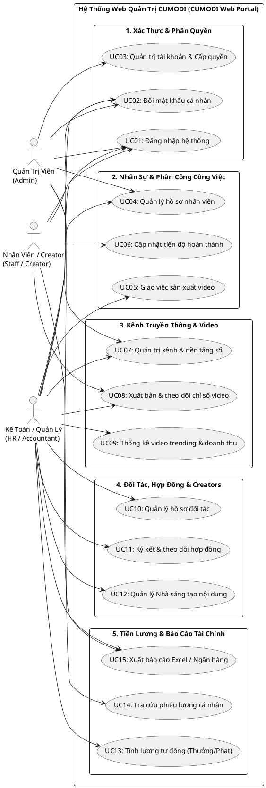

# BỘ GIÁO DỤC VÀ ĐÀO TẠO - ĐẠI HỌC HUẾ
## TRƯỜNG ĐẠI HỌC KINH TẾ
### KHOA HỆ THỐNG THÔNG TIN KINH TẾ

---

# BÁO CÁO ĐỒ ÁN HỌC PHẦN
## HỌC PHẦN: LẬP TRÌNH ỨNG DỤNG WEB

### ĐỀ TÀI:
# XÂY DỰNG HỆ THỐNG ỨNG DỤNG WEB QUẢN LÝ HOẠT ĐỘNG TRUYỀN THÔNG VÀ SẢN XUẤT NỘI DUNG SỐ CÔNG TY TNHH MTV CỨ MƠ ĐI (CUMODI)

---

- **Giảng viên hướng dẫn:** TS. Hà Ngọc Long
- **Sinh viên thực hiện:** Trần Viết Mạnh Cường
- **Mã sinh viên:** 23K4080003
- **Lớp sinh hoạt:** K57 Tin học kinh tế
- **Khóa học:** 2023 – 2027

*Thành phố Huế, năm 2026*

---

\newpage

## LỜI CẢM ƠN

Trong quá trình học tập, nghiên cứu và hoàn thành đồ án môn học **Lập trình ứng dụng web**, em đã nhận được sự quan tâm, chỉ dẫn tận tình từ quý Thầy, Cô giáo trong Khoa Hệ thống Thông tin Kinh tế – Trường Đại học Kinh tế, Đại học Huế.

Trước hết, em xin bày tỏ lòng biết ơn sâu sắc và chân thành nhất tới **Thầy TS. Hà Ngọc Long** – Giảng viên trực tiếp phụ trách và giảng dạy học phần Lập trình ứng dụng web. Trong suốt thời gian qua, Thầy đã tận tâm truyền đạt những kiến thức nền tảng và chuyên sâu về kiến trúc ứng dụng web, phương pháp phân tích thiết kế hệ thống, công nghệ xây dựng phần mềm hiện đại và định hướng giải quyết các vấn đề kỹ thuật phát sinh. Sự khích lệ và những định hướng học thuật quý báu của Thầy là động lực to lớn giúp em hoàn thành tốt đồ án này.

Em cũng xin gửi lời cảm ơn trân trọng tới toàn thể quý Thầy, Cô giáo Khoa Hệ thống Thông tin Kinh tế đã trang bị cho em hành trang kiến thức vững chắc về cơ sở dữ liệu, phân tích thiết kế hệ thống thông tin và kỹ thuật lập trình trong các kỳ học vừa qua.

Mặc dù em đã nỗ lực vận dụng tối đa các kiến thức đã học cùng tinh thần làm việc nghiêm túc, nhưng do thời gian và kinh nghiệm thực tế còn hạn chế nên bản báo cáo đồ án khó tránh khỏi những thiếu sót nhất định. Em rất kính mong nhận được những lời chỉ dẫn, nhận xét và đóng góp quý báu từ Thầy TS. Hà Ngọc Long để đồ án được hoàn thiện hơn nữa và làm nền tảng vững chắc cho quá trình học tập, nghiên cứu chuyên sâu trong tương lai.

*Em xin kính chúc Thầy dồi dào sức khỏe, hạnh phúc và gặt hái được nhiều thành công hơn nữa trong sự nghiệp giảng dạy và nghiên cứu khoa học!*

\begin{flushright}
*Huế, tháng 01 năm 2026*  
**Sinh viên thực hiện**  
*Trần Viết Mạnh Cường*
\end{flushright}

---

\newpage

## MỤC LỤC TỔNG QUAN

- **LỜI CẢM ƠN**
- **DANH MỤC THUẬT NGỮ VÀ KÝ HIỆU VIẾT TẮT**
- **DANH MỤC BẢNG BIỂU VÀ HÌNH ẢNH**
- **LỜI MỞ ĐẦU**
- **CHƯƠNG 1: TỔNG QUAN VỀ BÀI TOÁN VÀ KHẢO SÁT NGHIỆP VỤ DOANH NGHIỆP**
  - 1.1. Giới thiệu tổng quan về Công ty TNHH MTV Cứ Mơ Đi (CUMODI)
  - 1.2. Hiện trạng hoạt động và những thách thức trong công tác quản trị
  - 1.3. Mục tiêu và phạm vi xây dựng ứng dụng Web
  - 1.4. Đối tượng sử dụng và phân quyền hệ thống
- **CHƯƠNG 2: PHÂN TÍCH VÀ THIẾT KẾ HỆ THỐNG ỨNG DỤNG WEB**
  - 2.1. Phân tích yêu cầu chức năng (Functional Requirements)
  - 2.2. Phân tích yêu cầu phi chức năng (Non-Functional Requirements)
  - 2.3. Mô hình hóa chức năng bằng sơ đồ Use Case
  - 2.4. Thiết kế cơ sở dữ liệu quan hệ (Kế thừa và chuẩn hóa từ hệ thống 13 bảng thực thể)
  - 2.5. Ràng buộc toàn vẹn, Chỉ mục và Tối ưu hóa truy vấn CSDL
- **CHƯƠNG 3: THIẾT KẾ KIẾN TRÚC VÀ GIAO DIỆN ỨNG DỤNG WEB (UI/UX)**
  - 3.1. Lựa chọn mô hình kiến trúc phần mềm (Clean Architecture / N-tier Web Application)
  - 3.2. Cấu trúc tổ chức thư mục và giải pháp công nghệ
  - 3.3. Thiết kế luồng điều hướng (Site Map & Navigation)
  - 3.4. Thiết kế chi tiết giao diện người dùng các phân hệ chính
  - 3.5. Thiết kế đáp ứng đa thiết bị (Responsive Design 390px Mobile - Desktop)
- **CHƯƠNG 4: HIỆN THỰC HÓA VÀ CÀI ĐẶT CÁC PHÂN HỆ NGHIỆP VỤ**
  - 4.1. Hiện thực hóa cơ chế Xác thực & Phân quyền đa vai trò (RBAC & BCrypt)
  - 4.2. Phân hệ Quản trị Nhân sự, Phòng ban và Bảng phân công công việc
  - 4.3. Phân hệ Quản lý Kênh truyền thông, Nền tảng số và Thống kê Video
  - 4.4. Phân hệ Quản trị Hợp đồng kinh tế và Nhà sáng tạo nội dung (Creators)
  - 4.5. Phân hệ Tự động tính lương, Thưởng/Phạt và Báo cáo quyết toán
  - 4.6. Tích hợp các thành phần CSDL nâng cao (Views, Stored Procedures, Functions, Triggers)
- **CHƯƠNG 5: KIỂM THỬ HỆ THỐNG VÀ ĐÁNH GIÁ KẾT QUẢ**
  - 5.1. Môi trường và phương pháp kiểm thử
  - 5.2. Kịch bản kiểm thử chức năng then chốt (Test Cases)
  - 5.3. Kiểm thử an toàn bảo mật, chống lỗi IDOR và vượt quyền URL
  - 5.4. Đánh giá kết quả đạt được và hiệu năng hệ thống
- **KẾT LUẬN VÀ HƯỚNG PHÁT TRIỂN**
- **TÀI LIỆU THAM KHẢO**

---

\newpage

## DANH MỤC THUẬT NGỮ VÀ KÝ HIỆU VIẾT TẮT

| Viết tắt | Tên tiếng Anh đầy đủ | Diễn giải ý nghĩa |
| :--- | :--- | :--- |
| **CUMODI** | Cứ Mơ Đi | Tên giao dịch Công ty TNHH MTV Cứ Mơ Đi |
| **CSDL** | Cơ Sở Dữ Liệu | Database – Kho dữ liệu có cấu trúc |
| **ERD** | Entity Relationship Diagram | Sơ đồ thực thể mối quan hệ |
| **MCN** | Multi-Channel Network | Mạng lưới đa kênh truyền thông trực tuyến |
| **NSTND / Creator** | Content Creator | Nhà sáng tạo nội dung tham gia sản xuất video |
| **RBAC** | Role-Based Access Control | Cơ chế kiểm soát truy cập dựa trên vai trò |
| **API** | Application Programming Interface | Giao diện lập trình ứng dụng |
| **UI/UX** | User Interface / User Experience | Giao diện và trải nghiệm người dùng |
| **ORM** | Object-Relational Mapping | Kỹ thuật ánh xạ đối tượng với cơ sở dữ liệu quan hệ |
| **RDBMS** | Relational Database Management System | Hệ quản trị cơ sở dữ liệu quan hệ (SQL Server, MySQL) |
| **IDOR** | Insecure Direct Object References | Lỗ hổng tham chiếu đối tượng trực tiếp không an toàn |
| **REST** | Representational State Transfer | Phong cách kiến trúc phần mềm phân tán |
| **SPA** | Single Page Application | Ứng dụng web trang đơn |
| **SQL** | Structured Query Language | Ngôn ngữ truy vấn dữ liệu có cấu trúc |

---

\newpage

## LỜI MỞ ĐẦU

Trong kỷ nguyên kinh tế số và bùng nổ của mạng xã hội hiện đại, ngành công nghiệp truyền thông số, giải trí đa phương tiện và sản xuất video trực tuyến đã và đang có những bước tiến vượt bậc. Các nền tảng toàn cầu như YouTube, TikTok, Facebook, Instagram trở thành mảnh đất màu mỡ cho các doanh nghiệp sáng tạo nội dung phát triển mô hình kinh doanh, tiếp cận hàng chục triệu người xem và hợp tác với các nhãn hàng danh tiếng.

**Công ty TNHH MTV Cứ Mơ Đi (CUMODI)** là một doanh nghiệp sáng tạo nội dung số tiêu biểu, sở hữu mạng lưới nhiều kênh truyền thông sở hữu lượng người theo dõi lớn (như TogaTV, Hiha, Hachi, Mazk, Mel, Nabee, Sầu Riêng, Yummie, Buron...). Với mô hình hoạt động đa dạng từ việc ký kết hợp đồng quảng cáo tài trợ với đối tác, phân công nhiệm vụ sản xuất video chuyên sâu (viết kịch bản, làm model 3D, dựng bối cảnh, vẽ thumbnail, edit video), phối hợp với đội ngũ nhà sáng tạo nội dung (Creators), quản lý đa nền tảng cho đến tính toán chi trả tiền lương và doanh thu kênh, khối lượng dữ liệu phát sinh hàng ngày là vô cùng lớn và phức tạp.

Ở giai đoạn trước, việc thiết kế và xây dựng cơ sở dữ liệu quan hệ cho Công ty Cứ Mơ Đi trong học phần Cơ sở dữ liệu nâng cao đã hoàn thành việc chuẩn hóa cấu trúc 13 bảng thực thể, thiết lập các ràng buộc toàn vẹn, các khung nhìn (Views), thủ tục lưu trữ (Stored Procedures), hàm (Functions) và Trigger tự động hóa tính toán. Tuy nhiên, một hệ thống CSDL chỉ thực sự phát huy tối đa giá trị thực tiễn khi được tích hợp vào một **Ứng dụng Web hoàn chỉnh (Full-stack Web Application)** – nơi người dùng ở từng vị trí công việc có thể tương tác trực quan, thao tác thời gian thực thông qua trình duyệt web trên máy tính lẫn thiết bị di động.

Xuất phát từ yêu cầu thực tiễn đó, dưới sự hướng dẫn của **Thầy TS. Hà Ngọc Long**, em đã lựa chọn và triển khai đề tài: **"Xây dựng hệ thống ứng dụng Web quản lý hoạt động truyền thông và sản xuất nội dung số Công ty TNHH MTV Cứ Mơ Đi (CUMODI)"** cho đồ án học phần **Lập trình ứng dụng web**. Đề tài giải quyết bài toán chuyển hóa toàn bộ nền tảng dữ liệu nghiệp vụ thành một ứng dụng web hiện đại, an toàn, giao diện thân thiện, phân quyền chặt chẽ và tự động hóa quy trình nghiệp vụ của doanh nghiệp.

---

\newpage

# CHƯƠNG 1: TỔNG QUAN VỀ BÀI TOÁN VÀ KHẢO SÁT NGHIỆP VỤ DOANH NGHIỆP

## 1.1. Giới thiệu tổng quan về Công ty TNHH MTV Cứ Mơ Đi (CUMODI)
Công ty TNHH MTV Cứ Mơ Đi là doanh nghiệp hoạt động chuyên nghiệp trong lĩnh vực truyền thông, giải trí kỹ thuật số và sản xuất nội dung đa phương tiện trên các nền tảng mạng xã hội:
- **Tên doanh nghiệp:** CÔNG TY TNHH MTV CỨ MƠ ĐI
- **Mã doanh nghiệp:** 110
- **Mã số thuế:** 0315813288
- **Ngày thành lập:** 30/07/2019
- **Địa chỉ trụ sở:** 378/5 An Dương Vương, Phường Chợ Quán, Thành phố Hồ Chí Minh
- **Số điện thoại hotline:** 0876590909
- **Email liên hệ:** kydstudio@gmail.com
- **Kênh thông tin trực tuyến:** Trang mạng xã hội chính thức kết nối cộng đồng người xem và đối tác truyền thông.

Cơ cấu tổ chức của công ty bao gồm Ban Giám đốc và hệ thống các phòng ban chuyên môn hóa cao:
1. **Phòng Nội dung (Content - Mã: CT01):** Phụ trách nghiên cứu xu hướng, lên ý tưởng kịch bản, biên kịch câu chuyện.
2. **Phòng Kỹ thuật & Thiết kế (Thiết kế - Mã: TK01 & Animation - Mã: AMT01):** Phụ trách dựng model nhân vật 3D, thiết kế đồ họa, vẽ diễn hoạt chuyển động.
3. **Phòng Hậu kỳ & Biên tập (Edit - Mã: ED01):** Phụ trách cắt ghép, chèn hiệu ứng âm thanh, xử lý kỹ xảo video và xuất bản sản phẩm.
4. **Phòng Setup Bối cảnh (Set up - Mã: SU01 & Vẽ - Mã: VE01):** Phụ trách xây dựng bối cảnh trường quay, thiết lập map game Minecraft/Roblox và vẽ thumbnail đại diện.
5. **Phòng Kế toán (Mã: KT01):** Phụ trách quản lý hợp đồng tài trợ, quản trị công nợ, tính lương nhân viên và tổng hợp doanh thu kênh.
6. **Phòng Nhân sự (Mã: NS01):** Phụ trách hồ sơ nhân viên, chế độ bảo hiểm xã hội, theo dõi tiến độ công việc và hợp tác Creator.

## 1.2. Hiện trạng hoạt động và những thách thức trong công tác quản trị
Trong mô hình hoạt động của mạng lưới sáng tạo nội dung số (MCN), công ty phải đối mặt với các bài toán quản lý đặc thù:
1. **Quản lý đa kênh trên đa nền tảng:** Mỗi kênh (như TogaTV, Mazk, Hachi...) đồng thời phát sóng trên nhiều nền tảng (YouTube, TikTok, Facebook, Instagram) với các chỉ số lượt xem (views), lượt tương tác (likes, comments) và doanh thu biến động liên tục theo thời gian thực.
2. **Mạng lưới cộng tác viên và Creators phong phú:** Bên cạnh nhân sự chính thức tại các phòng ban, công ty hợp tác với hàng chục nhà sáng tạo nội dung (Creators) bên ngoài. Mỗi video có thể có sự tham gia của một hoặc nhiều Creators, đòi hỏi cơ chế theo dõi sự đóng góp và thanh toán rõ ràng.
3. **Quy trình sản xuất video phân rã nhiều công đoạn:** Một video từ lúc lên ý tưởng đến khi phát hành phải trải qua ít nhất 5-7 công việc con (Kịch bản, Model 3D, Setup Map, Quay bối cảnh, Thu âm lồng tiếng, Edit, Thiết kế Thumbnail). Việc quản lý thủ công dễ dẫn đến trễ tiến độ, thất lạc tài nguyên và phân chia khối lượng công việc không đồng đều giữa các nhân sự.
4. **Quyết toán tiền lương gắn liền với thưởng phạt và doanh thu:** Thu nhập của nhân sự và Creators gồm lương cơ bản, các khoản thưởng theo hiệu suất video/tiến độ công việc và các khoản khấu trừ phạt do vi phạm quy chế hoặc trễ hạn. Việc tính toán thủ công bằng bảng tính Excel rời rạc tiềm ẩn nhiều sai sót và khó bảo mật thông tin thu nhập.

## 1.3. Mục tiêu và phạm vi xây dựng ứng dụng Web
- **Mục tiêu tổng quát:** Xây dựng một Cổng thông tin điện tử (Enterprise Web Portal) đồng bộ, hiện đại, cho phép số hóa toàn diện quy trình quản lý nhân sự, phân công công việc, theo dõi hiệu suất video, quản lý hợp đồng đối tác và tự động hóa tính lương cho Công ty Cứ Mơ Đi.
- **Mục tiêu kỹ thuật:**
  - Ứng dụng kiến trúc phân tầng chuẩn mực, phân tách độc lập giữa giao diện người dùng (UI), tầng xử lý nghiệp vụ (Business Logic) và tầng truy xuất cơ sở dữ liệu (Data Access).
  - Khai thác trọn vẹn và kế thừa cấu trúc CSDL 13 bảng thực thể đã được chuẩn hóa 3NF trong đồ án CSDL nâng cao, tích hợp các View, Stored Procedure, Function và Trigger tự động.
  - Xây dựng giao diện web thân thiện, tương thích tối ưu trên cả máy tính bàn và màn hình điện thoại di động (Responsive Design).
  - Thiết lập cơ chế xác thực an toàn, mã hóa mật khẩu một chiều BCrypt và phân quyền kiểm soát truy cập nghiêm ngặt theo vai trò (RBAC).

## 1.4. Đối tượng sử dụng và phân quyền hệ thống
Hệ thống phân định 3 nhóm người dùng chính:
1. **Quản trị viên hệ thống (Admin):** Toàn quyền cấu hình hệ thống, quản lý tài khoản người dùng, phân quyền vai trò, quản lý danh mục phòng ban, kênh truyền thông và nền tảng.
2. **Kế toán & Trưởng phòng Quản lý (Manager / HR-Accountant):** Quản lý hợp đồng đối tác, phê duyệt và giao việc cho nhân sự, kiểm soát tiến độ sản xuất video, chạy bảng tính lương tự động, chốt khóa sổ kỳ lương và xuất báo cáo doanh thu/chi trả ngân hàng.
3. **Nhân viên & Nhà sáng tạo nội dung (Staff / Creator):** Đăng nhập xem bảng công việc được giao, cập nhật tiến độ công việc, tra cứu thông tin kênh/video phụ trách và tra cứu phiếu lương cá nhân (bảo mật nghiêm ngặt chống xem lén lương đồng nghiệp).

---

\newpage

# CHƯƠNG 2: PHÂN TÍCH VÀ THIẾT KẾ HỆ THỐNG ỨNG DỤNG WEB

## 2.1. Phân tích yêu cầu chức năng (Functional Requirements)
Hệ thống được thiết kế với 5 phân hệ chức năng cốt lõi:

```
+-----------------------------------------------------------------------------------+
|               HỆ THỐNG ỨNG DỤNG WEB CÔNG TY CỨ MƠ ĐI (CUMODI WEB PORTAL)           |
+-----------------------------------------------------------------------------------+
        |                      |                      |                     |
        v                      v                      v                     v
+----------------+     +----------------+     +---------------+     +---------------+
| Phân hệ 1:     |     | Phân hệ 2:     |     | Phân hệ 3:    |     | Phân hệ 4 & 5:|
| XÁC THỰC &     |     | NHÂN SỰ &      |     | KÊNH, VIDEO & |     | HỢP ĐỒNG,     |
| BẢO MẬT RBAC   |     | CÔNG VIỆC      |     | NỀN TẢNG SỐ   |     | LƯƠNG & D-THU |
+----------------+     +----------------+     +---------------+     +---------------+
```

1. **Phân hệ 1: Xác thực người dùng và Quản trị bảo mật (UC_AUTH):**
   - Đăng nhập vào hệ thống bằng tên đăng nhập và mật khẩu được băm mã hóa một chiều qua thuật toán BCrypt.
   - Quản lý phiên làm việc, tự động lưu thông tin định danh và vai trò (Role) trong Claims.
   - Cho phép người dùng cá nhân đổi mật khẩu bảo mật tài khoản.
   - Đăng xuất an toàn, xóa sạch phiên làm việc trên trình duyệt.
2. **Phân hệ 2: Quản lý Nhân sự, Phòng ban và Tiến độ công việc (UC_STAFF_TASK):**
   - Quản lý danh bạ nhân sự theo 8 phòng ban chức năng (Animation, Content, Edit, Setup, Vẽ, Kế toán, Nhân sự, Thiết kế).
   - Giao việc cho nhân sự gắn liền với từng video cụ thể (Kịch bản, Model 3D, Setup Map, Edit, Vẽ Thumbnail).
   - Cập nhật tiến độ hoàn thành công việc (0% – 100%), ngày giao, ngày kết thúc và ghi chú thực hiện.
3. **Phân hệ 3: Quản trị Kênh truyền thông, Nền tảng và Video (UC_CHANNEL_VIDEO):**
   - Quản lý danh mục nền tảng số (YouTube, Facebook, TikTok, Instagram).
   - Quản lý danh sách các kênh thương hiệu trực thuộc công ty và phân công nhân sự quản trị kênh.
   - Quản lý thông tin video xuất bản: Tên video, ngày đăng, nội dung tóm tắt, số lượt xem (views), số lượt thích (likes), bình luận.
   - Thống kê tự động danh sách các video trending (> 100,000 lượt xem) và tính toán lượt xem trung bình của từng kênh.
4. **Phân hệ 4: Quản lý Hợp đồng đối tác và Nhà sáng tạo nội dung (UC_PARTNER_CREATOR):**
   - Quản lý hồ sơ đối tác doanh nghiệp, khách hàng tài trợ quảng cáo và nhãn hàng booking.
   - Quản lý hợp đồng kinh tế: Số hợp đồng, ngày tạo, ngày ký, nội dung cam kết và bảng giá giá trị hợp đồng.
   - Quản lý hồ sơ các Nhà sáng tạo nội dung (Creators), biệt danh, hợp đồng hợp tác và danh sách video tham gia.
5. **Phân hệ 5: Tính toán Lương tự động, Thưởng/Phạt và Báo cáo Doanh thu (UC_PAYROLL_REV):**
   - Tự động tính toán thành tiền lương của nhân viên theo công thức: $\text{Lương thành tiền} = \text{Lương cơ bản} + \text{Thưởng} - \text{Phạt}$.
   - Tự động cập nhật doanh thu kênh dựa trên biến động lượt xem video thực tế với tỷ lệ quy đổi: $1 \text{ view} = 100 \text{ VNĐ}$.
   - Xuất dữ liệu bảng thanh toán lương và báo cáo tài chính ra file Excel/CSV phục vụ công tác thanh toán ngân hàng.

## 2.2. Phân tích yêu cầu phi chức năng (Non-Functional Requirements)
1. **Tính tương thích và Responsive:** Ứng dụng web hiển thị chuẩn xác, không vỡ layout trên các độ phân giải màn hình từ Desktop (1920x1080, 1366x768), Tablet đến Mobile điện thoại (chuẩn kiểm thử 390px chiều ngang).
2. **Hiệu năng và Tốc độ xử lý:**
   - Thời gian phản hồi trang đối với các thao tác truy vấn dữ liệu dưới 1.5 giây trong điều kiện tải bình thường.
   - Các thao tác cập nhật dữ liệu hàng loạt (Batch Processing) sử dụng Transaction đảm bảo nguyên tắc ACID (Toàn vẹn, Nhất quán, Cô lập, Bền vững).
3. **Bảo mật và An toàn thông tin:**
   - 100% mật khẩu người dùng lưu trữ trong cơ sở dữ liệu phải được băm bằng giải thuật BCrypt với Salt ngẫu nhiên, tuyệt đối không lưu plain-text.
   - Ngăn chặn triệt để lỗ hổng SQL Injection bằng việc sử dụng truy vấn tham số hóa (Parameterized Queries) trên toàn bộ các lệnh tương tác CSDL.
   - Ngăn chặn lỗ hổng IDOR (Insecure Direct Object References): Nhân viên chỉ được xem phiếu lương và thông tin cá nhân của chính mình dựa trên Claims định danh từ phiên đăng nhập.
   - Chặn người dùng chưa đăng nhập hoặc không đủ quyền hạn gõ trực tiếp URL vào các phân hệ quản trị (phản hồi mã lỗi HTTP 403 Forbidden).

## 2.3. Mô hình hóa chức năng bằng sơ đồ Use Case
Dưới đây là sơ đồ ca sử dụng tổng quan của ứng dụng web được mô hình hóa bằng ngôn ngữ PlantUML:



## 2.4. Thiết kế cơ sở dữ liệu quan hệ (Kế thừa và chuẩn hóa 13 bảng thực thể)
Cơ sở dữ liệu của ứng dụng web được kế thừa và đồng bộ 100% từ cấu trúc chuẩn 3NF của hồ sơ CSDL Công ty Cứ Mơ Đi, bao gồm 13 bảng thực thể nghiệp vụ:

### 1. Bảng `CONGTY` (Thông tin pháp lý công ty)
- `MaCT` (INT, Khóa chính, IDENTITY): Mã định danh công ty (Giá trị mặc định: 110).
- `TenCT` (NVARCHAR(50), NOT NULL): Tên pháp lý đầy đủ của công ty.
- `NgayTL` (DATE): Ngày thành lập doanh nghiệp (30/07/2019).
- `DiaChi` (NVARCHAR(150)): Địa chỉ trụ sở công ty.
- `SDT` (NVARCHAR(15), NOT NULL): Số điện thoại liên hệ chính thức.
- `Email` (NVARCHAR(100)): Thư điện tử doanh nghiệp.
- `MaSoThue` (NVARCHAR(20)): Mã số thuế doanh nghiệp (0315813288).

### 2. Bảng `PHONGBAN` (Phòng ban chức năng)
- `MaPB` (NVARCHAR(10), Khóa chính): Mã phòng ban (AMT01, CT01, ED01, KT01, NS01, SU01, TK01, VE01).
- `TenPB` (NVARCHAR(50), NOT NULL): Tên gọi phòng ban chức năng.
- `MaCT` (INT, NOT NULL, Khóa ngoại $\rightarrow$ `CONGTY(MaCT)`): Thuộc công ty nào.
- `SoNS` (INT, DEFAULT 0): Số lượng nhân sự hiện tại của phòng ban (Tự động cập nhật bởi Trigger).

### 3. Bảng `NHANSU` (Hồ sơ nhân viên chính thức)
- `MaNS` (NVARCHAR(10), Khóa chính): Mã nhân sự định danh duy nhất (NS001, NS002, ..., NS021).
- `HoTenNS` (NVARCHAR(60), NOT NULL): Họ và tên nhân viên.
- `NgaySinh` (DATE, NOT NULL): Ngày tháng năm sinh.
- `GioiTinh` (NVARCHAR(10), NOT NULL, Ràng buộc CHECK 'Nam'/'Nữ'): Giới tính.
- `DiaChi` (NVARCHAR(100)): Địa chỉ tạm trú/thường trú.
- `QueQuan` (NVARCHAR(60)): Quê quán nguyên quán.
- `ChucVu` (NVARCHAR(30), NOT NULL): Vị trí đảm nhiệm (Kế toán, Nhân sự, Editor, Thợ dựng, Thợ vẽ, Thợ xây...).
- `Luong` (INT, NOT NULL, Ràng buộc CHECK >= 0): Mức lương thỏa thuận cơ bản hàng tháng.
- `BHXH` (NVARCHAR(25)): Mã số sổ Bảo hiểm xã hội.
- `PHONGBAN_MaPB` (NVARCHAR(10), NOT NULL, Khóa ngoại $\rightarrow$ `PHONGBAN(MaPB)`): Thuộc phòng ban.
- `TongCongViec` (INT, DEFAULT 0): Tổng số công việc được giao (Tự động cập nhật bởi Trigger).

### 4. Bảng `DOITAC` (Hồ sơ đối tác doanh nghiệp / Khách hàng)
- `MaDT` (INT, Khóa chính, IDENTITY): Mã đối tác.
- `HoTenDT` (NVARCHAR(60), NOT NULL): Tên đối tác / Người đại diện tổ chức.
- `NgaySinh` (DATE): Ngày sinh người đại diện.
- `DiaChi` (NVARCHAR(100)): Trụ sở làm việc của đối tác.
- `SDT` (NVARCHAR(15), NOT NULL, Ràng buộc CHECK 10 chữ số): Số điện thoại liên hệ.
- `Email` (NVARCHAR(100)): Email trao đổi hợp đồng.
- `MaSoThue` (NVARCHAR(20)): Mã số thuế đối tác.

### 5. Bảng `HOPDONG` (Hợp đồng kinh tế tài trợ / quảng cáo)
- `MaHD` (INT, Khóa chính, IDENTITY): Mã hợp đồng kinh tế.
- `TenHD` (NVARCHAR(100), NOT NULL): Tên gọi hợp đồng dịch vụ truyền thông.
- `NgayTaoHD` (DATE, NOT NULL): Ngày khởi tạo văn bản hợp đồng.
- `NoiDung` (NVARCHAR(255)): Nội dung thỏa thuận công việc.
- `BangGia` (NVARCHAR(50)): Giá trị thanh toán hợp đồng (VNĐ).
- `NgayKiHD` (DATE, NOT NULL, Ràng buộc CHECK `NgayKiHD >= NgayTaoHD`): Ngày ký kết chính thức.
- `CONGTY_MaCT` (INT, NOT NULL, Khóa ngoại $\rightarrow$ `CONGTY(MaCT)`): Đơn vị cung cấp dịch vụ.
- `DOITAC_MaDT` (INT, NOT NULL, Khóa ngoại $\rightarrow$ `DOITAC(MaDT)`): Đơn vị ký kết thuê dịch vụ.

### 6. Bảng `NENTANG` (Nền tảng truyền thông số)
- `MaNT` (NVARCHAR(10), Khóa chính): Mã nền tảng (YT01, FB01, TT01, IG01).
- `TenNenTang` (NVARCHAR(50), NOT NULL): Tên nền tảng (YouTube, Facebook, TikTok, Instagram).

### 7. Bảng `KENH` (Kênh truyền thông thương hiệu)
- `MaKenh` (NVARCHAR(10), Khóa chính): Mã kênh thương hiệu (TG01, HH01, HC01, MA01, NB01...).
- `TenKenh` (NVARCHAR(50), NOT NULL): Tên kênh hiển thị công khai (TogaTV, Hiha, Hachi, Mazk...).
- `HinhDaiDien` (NVARCHAR(255)): Đường dẫn ảnh đại diện/logo kênh.
- `NgayTaoKenh` (DATE): Ngày thành lập kênh truyền thông.
- `NHANSU_MaNS` (NVARCHAR(10), NOT NULL, Khóa ngoại $\rightarrow$ `NHANSU(MaNS)`): Nhân viên phụ trách quản lý kênh.
- `CONGTY_MaCT` (INT, NOT NULL, Khóa ngoại $\rightarrow$ `CONGTY(MaCT)`): Thuộc sở hữu công ty.
- `soLuongVideo` (INT, DEFAULT 0): Tổng số video xuất bản của kênh (Tự động cập nhật bởi Trigger).

### 8. Bảng `CHITIETKENH` (Quan hệ Kênh – Nền tảng số đa kênh)
- `KENH_MaKenh` (NVARCHAR(10), Khóa ngoại $\rightarrow$ `KENH(MaKenh)`).
- `NENTANG_MaNT` (NVARCHAR(10), Khóa ngoại $\rightarrow$ `NENTANG(MaNT)`).
- Khóa chính kết hợp: `(KENH_MaKenh, NENTANG_MaNT)`.

### 9. Bảng `VIDEO` (Quản lý video xuất bản)
- `MaVideo` (INT, Khóa chính, IDENTITY): Mã định danh video.
- `TenVideo` (NVARCHAR(150), NOT NULL): Tiêu đề video xuất bản.
- `NgayDang` (DATE, NOT NULL): Ngày đăng tải công khai.
- `NoiDung` (NVARCHAR(255)): Mô tả nội dung video.
- `LuotXem` (INT, DEFAULT 0, CHECK >= 0): Tổng lượt xem video.
- `LuotThich` (INT, DEFAULT 0, CHECK >= 0): Tổng lượt yêu thích video.
- `BinhLuan` (NVARCHAR(255)): Tổng số lượng bình luận ghi nhận.
- `KENH_MaKenh` (NVARCHAR(10), NOT NULL, Khóa ngoại $\rightarrow$ `KENH(MaKenh)`): Kênh phát hành video.

### 10. Bảng `NHASANGTAOND` (Hồ sơ Nhà sáng tạo nội dung - Creators)
- `MaNSTND` (NVARCHAR(10), Khóa chính): Mã định danh Creator (CR001, CR002, ..., CR015).
- `HoTenNSTND` (NVARCHAR(60), NOT NULL): Họ và tên thật.
- `BietDanh` (NVARCHAR(30), NOT NULL): Nghệ danh / Biệt danh (Hachi, Hiha, Mazk, JackVN, Nabee, Yummie...).
- `NgaySinh` (DATE): Ngày tháng năm sinh.
- `QueQuan` (NVARCHAR(60)): Quê quán.
- `SDT` (NVARCHAR(15)): Số điện thoại liên hệ cá nhân.
- `Email` (NVARCHAR(100)): Hòm thư điện tử.
- `NgayKyHopTac` (DATE): Ngày ký hợp đồng hợp tác sáng tạo.
- `CONGTY_MaCT` (INT, NOT NULL, Khóa ngoại $\rightarrow$ `CONGTY(MaCT)`): Công ty chủ quản.

### 11. Bảng `CHITIETVIDEO` (Quan hệ Video – Nhà sáng tạo tham gia)
- `VIDEO_MaVideo` (INT, Khóa ngoại $\rightarrow$ `VIDEO(MaVideo)`).
- `NHASANGTAOND_MaNSTND` (NVARCHAR(10), Khóa ngoại $\rightarrow$ `NHASANGTAOND(MaNSTND)`).
- Khóa chính kết hợp: `(VIDEO_MaVideo, NHASANGTAOND_MaNSTND)`.

### 12. Bảng `CONGVIEC` (Danh mục công việc sản xuất video)
- `MaCV` (INT, Khóa chính): Mã định danh công việc (15021, 20026, 20028...).
- `TenCV` (NVARCHAR(100), NOT NULL): Tên công việc (Viết kịch bản, Thiết kế models, Dựng bối cảnh, Setup Map...).
- `NgayBatDau` (DATE, NOT NULL): Thời điểm bắt đầu triển khai.
- `NgayKetThuc` (DATE, NOT NULL, Ràng buộc CHECK `NgayKetThuc >= NgayBatDau`): Hạn chót hoàn thành.
- `NoiDungCV` (NVARCHAR(255)): Yêu cầu chi tiết của công việc.
- `TienDoHoanThanh` (NVARCHAR(20), DEFAULT '0%'): Tiến độ thực tế (ví dụ: '100%').
- `VIDEO_MaVideo` (INT, NOT NULL, Khóa ngoại $\rightarrow$ `VIDEO(MaVideo)`): Sản xuất cho video nào.
- `NHASANGTAOND_MaNSTND` (NVARCHAR(10), Khóa ngoại $\rightarrow$ `NHASANGTAOND(MaNSTND)`): Creator liên quan.

### 13. Bảng `CHITIETCONGVIEC` (Phân công nhân sự thực hiện công việc)
- `NHANSU_MaNS` (NVARCHAR(10), Khóa ngoại $\rightarrow$ `NHANSU(MaNS)`): Nhân sự nhận nhiệm vụ.
- `CONGVIEC_MaCV` (INT, Khóa ngoại $\rightarrow$ `CONGVIEC(MaCV)`): Công việc được phân công.
- `NgayGiao` (DATE, NOT NULL): Ngày giao việc chính thức.
- `NgayHoanThanh` (DATE, NOT NULL): Ngày nhân sự hoàn thành công việc.
- Khóa chính kết hợp: `(NHANSU_MaNS, CONGVIEC_MaCV)`.

### Các bảng mở rộng phục vụ Quyết toán & Quản trị Web:
- **Bảng `BANGLUONG` (Tính lương chi tiết từng kỳ):**
  - `MaLuong` (INT, IDENTITY, Khóa chính).
  - `MaNS` (NVARCHAR(10), Khóa ngoại $\rightarrow$ `NHANSU(MaNS)`).
  - `Thang` (INT), `Nam` (INT).
  - `Thuong` (INT, DEFAULT 0): Tiền thưởng hiệu suất/tiến độ.
  - `Phat` (INT, DEFAULT 0): Khấu trừ phạt vi phạm quy chế.
  - `LuongThanhTien` (INT): Thu nhập thực lĩnh (Tự động tính toán bởi Trigger: $\text{Lương CB} + \text{Thưởng} - \text{Phạt}$).
- **Bảng `DOANHTHUKENH` (Doanh thu tích lũy kênh theo lượt xem):**
  - `MaKenh` (NVARCHAR(10), Khóa chính & Khóa ngoại $\rightarrow$ `KENH(MaKenh)`).
  - `TongLuotXem` (INT, DEFAULT 0): Lũy kế lượt xem toàn bộ video thuộc kênh.
  - `TongDoanhThu` (DECIMAL(15,2), DEFAULT 0): Doanh thu quy đổi tự động: $\text{Tổng lượt xem} \times 100 \text{ đ}$.
  - `NgayCapNhat` (DATETIME): Thời điểm đồng bộ lượt xem mới nhất.

## 2.5. Ràng buộc toàn vẹn, Chỉ mục và Tối ưu hóa truy vấn CSDL
Để đảm bảo chất lượng dữ liệu cao nhất cho hệ thống web, các ràng buộc toàn vẹn (Integrity Constraints) được cài đặt trực tiếp tại mức CSDL:
1. `CHK_Luong_Duong`: Bắt buộc mức lương nhân sự phải luôn là số không âm: `CHECK (Luong >= 0)`.
2. `CHK_ThoiGianCongViec`: Đảm bảo thời gian hoàn thành công việc không được trước ngày bắt đầu: `CHECK (NgayKetThuc >= NgayBatDau)`.
3. `CHK_GioiTinh`: Ràng buộc giới tính nhân viên chỉ nhận một trong hai giá trị hợp lệ: `CHECK (GioiTinh IN (N'Nam', N'Nữ'))`.
4. `CHK_EmailDinhDang`: Đảm bảo tính hợp lệ của định dạng thư điện tử: `CHECK (Email LIKE '_%@gmail.com')`.
5. `CHK_NgayKiHopDong`: Đảm bảo ngày ký kết hợp đồng không được diễn ra trước ngày khởi tạo văn bản: `CHECK (NgayKiHD >= NgayTaoHD)`.
6. `CHK_SDT_DinhDang`: Đảm bảo số điện thoại liên hệ phải chứa đúng 10 ký tự số từ 0 đến 9: `CHECK (SDT LIKE '[0-9][0-9][0-9][0-9][0-9][0-9][0-9][0-9][0-9][0-9]')`.

---

\newpage

# CHƯƠNG 3: THIẾT KẾ KIẾN TRÚC VÀ GIAO DIỆN ỨNG DỤNG WEB (UI/UX)

## 3.1. Lựa chọn mô hình kiến trúc phần mềm
Nhằm xây dựng một ứng dụng web có khả năng bảo trì cao, dễ dàng mở rộng và tách biệt rõ ràng giữa các mối quan tâm (Separation of Concerns), hệ thống được thiết kế theo mô hình **Kiến trúc Phân tầng Hiện đại (Clean Architecture / N-tier Layered Architecture)**:

```
[ TẦNG 1: PRESENTATION LAYER (GIAO DIỆN NGƯỜI DÙNG) ]
  • Blazor Server Components / Razor Pages (.razor)
  • Bootstrap 5 Modern CSS, Responsive Mobile UI 390px
  • FontAwesome Icons, ApexCharts / Chart.js Dashboard
           |
           v (Gọi thông qua Dependency Injection Interfaces)
[ TẦNG 2: APPLICATION & USE CASES LAYER (XỬ LÝ NGHIỆP VỤ) ]
  • Use Case Classes: ManageStaffUseCase, AssignTaskUseCase,
    PublishVideoUseCase, CalculatePayrollUseCase, ExportExcelUseCase
  • Phân quyền RBAC, kiểm tra quyền sở hữu (Anti-IDOR)
           |
           v (Thao tác trên các thực thể độc lập)
[ TẦNG 3: CORE DOMAIN LAYER (MÔ HÌNH MIỀN & THỰC THỂ CỐT LÕI) ]
  • Entities: Company, Department, Employee, Channel, Video, Creator,
    Contract, Task, Payroll, ChannelRevenue
  • Domain Rules: Công thức tính lương, Quy tắc tính doanh thu kênh
           ^
           | (Triển khai các Interface của UseCases)
[ TẦNG 4: INFRASTRUCTURE & DATA ACCESS LAYER (TRUY XUẤT CSDL) ]
  • Micro-ORM Dapper / ADO.NET kết nối SQL Server & MySQL
  • Triển khai Transactions (BeginTransaction, Commit, Rollback)
  • Gọi các Stored Procedures, Views, Functions và Triggers
```

**Nguyên tắc phụ thuộc (Dependency Rule):**
- Tầng bên trong (`Core Domain` và `Use Cases`) độc lập hoàn toàn với công nghệ giao diện và hệ quản trị CSDL bên ngoài.
- Tầng giao diện (`Web Presentation`) chỉ phụ thuộc vào các `Interface` nghiệp vụ được định nghĩa ở tầng `Use Cases`, không phụ thuộc trực tiếp vào các lớp truy xuất CSDL cụ thể.
- Tầng hạ tầng (`Data Access Layer`) nằm ở vòng ngoài cùng, hiện thực hóa các `Interface Repository` bằng thư viện truy vấn tối ưu (Dapper Micro-ORM) với 100% câu lệnh tham số hóa.

## 3.2. Cấu trúc tổ chức thư mục và giải pháp công nghệ
- **Ngôn ngữ & Nền tảng:** C# trên nền .NET 10 (hoặc ASP.NET Core Web Application).
- **Công nghệ hiển thị UI:** Blazor Interactive Server kết hợp SignalR thời gian thực, cập nhật dữ liệu tức thì mà không cần tải lại toàn bộ trang (Full Page Reload).
- **Thư viện giao diện:** Bootstrap 5.3, Vanilla CSS tùy biến chuẩn Typography Plus Jakarta Sans / Inter, FontAwesome 6 Pro icons.
- **Hệ quản trị cơ sở dữ liệu:** Microsoft SQL Server 2022 / Express (đồng thời tương thích hoàn toàn với MySQL/MariaDB như đã chứng minh ở đồ án CSDL).
- **Bảo mật:** `BCrypt.Net-Next` dùng để băm và kiểm chứng mật khẩu với Salt ngẫu nhiên; `AuthenticationStateProvider` quản lý ClaimsPrincipal đăng nhập.

## 3.3. Thiết kế luồng điều hướng (Site Map & Navigation)
Hệ thống web được thiết kế với thanh điều hướng trên cùng (Top Navbar) co giãn linh hoạt và cây thư mục chức năng rõ ràng:
1. **Trang Chủ (Dashboard - `/`):** Hiển thị các thẻ chỉ số KPI tổng quan (Tổng số kênh, số video, tổng lượt xem, tổng doanh thu quy đổi, số lượng nhân sự, công việc đang thực hiện).
2. **Phân hệ Nhân sự & Phân công (`/staff-tasks`):**
   - Danh sách nhân sự theo phòng ban.
   - Bảng phân công công việc chi tiết theo từng video.
   - Thao tác giao việc mới và cập nhật tiến độ công việc (0% - 100%).
3. **Phân hệ Kênh & Video Đa Nền Tảng (`/channels-videos`):**
   - Danh mục các kênh thương hiệu (TogaTV, Mazk, Hachi, Hiha...).
   - Danh sách video xuất bản kèm chỉ số views, likes, bình luận.
   - Bộ lọc xem danh sách video trending (> 100,000 views) và thống kê doanh thu tự động.
4. **Phân hệ Đối Tác & Hợp Đồng (`/partners-contracts`):**
   - Hồ sơ đối tác tài trợ, nhãn hàng hợp tác.
   - Danh mục hợp đồng kinh tế và giá trị thanh toán.
   - Danh sách các Nhà sáng tạo nội dung (Creators) và các video tham gia.
5. **Phân hệ Tiền Lương & Quyết Toán (`/payroll` - Chỉ dành cho Quản lý & Kế toán):**
   - Bảng tính lương tự động hàng loạt toàn công ty.
   - Thao tác thêm thưởng/phạt cho nhân sự.
   - Nút chức năng "Xuất Excel Bảng Lương" và "Xuất CSV Ngân Hàng".
6. **Trang Cá Nhân & Tra Cứu (`/my-profile`, `/my-payslip`):**
   - Tra cứu hồ sơ nhân viên đăng nhập.
   - Xem chi tiết phiếu lương cá nhân của chính mình.
   - Form đổi mật khẩu bảo mật tài khoản.

## 3.4. Thiết kế chi tiết giao diện người dùng các phân hệ chính
Giao diện ứng dụng web được thiết kế theo phong cách hiện đại (Modern Enterprise SaaS), sử dụng bảng màu chủ đạo Indigo/Blue (`#1e293b`, `#2563eb`), độ tương phản cao, các thẻ Card bo góc mềm mại (`border-radius: 12px`), hiệu ứng đổ bóng nhẹ (`box-shadow`) và trạng thái màu sắc kế toán chuẩn mực (Xanh lá cho thành công/thu nhập, Đỏ cho khấu trừ/cảnh báo, Vàng cho ca gãy/thưởng phạt).

1. **Giao diện Trang Đăng Nhập (`/login`):**
   - Form đăng nhập chuẩn `<EditForm>` với hai ô nhập Tên đăng nhập và Mật khẩu.
   - Tích hợp tính năng hiển thị/ẩn mật khẩu bằng icon con mắt.
   - Hiển thị thông báo lỗi trực tiếp cạnh ô nhập khi để trống hoặc nhập sai định dạng.
   - Bổ sung bảng chọn nhanh vai trò (Quick Login Demo) cho phép giảng viên/người chấm chọn ngay tài khoản Admin, Kế toán hoặc Nhân viên để kiểm thử nhanh chóng.
2. **Giao diện Dashboard Tổng quan:**
   - 4 khối thẻ thống kê trực quan: Tổng Lượt Xem (views), Doanh Thu Quy Đổi (VNĐ), Tổng Số Video Xuất Bản, Tổng Số Nhân Sự & Creators.
   - Biểu đồ phân bổ lượt xem giữa các nền tảng (YouTube, Facebook, TikTok).
   - Bảng top 5 video trending có lượt xem cao nhất.
3. **Giao diện Bảng Phân Công Công Việc:**
   - Bảng hiển thị: Mã công việc, Tên công việc, Video liên quan, Nhân sự thực hiện, Ngày bắt đầu, Ngày kết thúc, Thanh tiến độ (Progress Bar 0% - 100%).
   - Nút cập nhật nhanh tiến độ kèm modal chỉnh sửa trực quan.
4. **Giao diện Tính Lương & Xuất Báo Cáo:**
   - Thống kê Quỹ lương gộp, Tổng tiền thưởng, Tổng tiền phạt, Thực lĩnh chuyển khoản.
   - Nút hành động 1-chạm "Xuất Excel Bảng Lương (.xls)" theo đúng mẫu biểu kế toán.

## 3.5. Thiết kế đáp ứng đa thiết bị (Responsive Design 390px Mobile - Desktop)
- Trên máy tính bàn (Desktop): Bố cục hiển thị lưới dạng Dashboard đa cột, thanh menu trải ngang dễ nhìn, các bảng dữ liệu hiển thị đầy đủ thông tin chi tiết.
- Trên điện thoại di động (kiểm thử chuẩn DevTools width 390px – iPhone 12/14/15/16):
  - Thanh Navbar tự động thu gọn vào nút Menu Hamburger (Toggler Collapse).
  - Các khối Card thống kê tự động chuyển thành dạng 1 cột dọc (`col-12`).
  - Toàn bộ bảng dữ liệu được bao bọc trong lớp `table-responsive`, hỗ trợ vuốt cuộn ngang mượt mà bằng ngón tay mà không bị tràn màn hình hay vỡ layout.
  - Các nút thao tác (Xem, Sửa, Xóa) có kích thước bấm tối thiểu 40x40px, đảm bảo trải nghiệm cảm ứng thuận tiện.

---

\newpage

# CHƯƠNG 4: HIỆN THỰC HÓA VÀ CÀI ĐẶT CÁC PHÂN HỆ NGHIỆP VỤ

## 4.1. Hiện thực hóa cơ chế Xác thực & Phân quyền đa vai trò (RBAC & BCrypt)
Hệ thống sử dụng dịch vụ xác thực tùy biến tích hợp `CustomAuthenticationStateProvider`. Khi người dùng đăng nhập:
1. Mật khẩu gửi lên được kiểm chứng bằng hàm `BCrypt.Net.BCrypt.Verify(rawPassword, passwordHash)` đối chiếu với bản ghi trong bảng `user_accounts`.
2. Nếu hợp lệ, hệ thống tạo một `ClaimsIdentity` chứa:
   - `ClaimTypes.Name`: Tên tài khoản.
   - `ClaimTypes.Role`: Vai trò phân quyền (`ROLE_ADMIN`, `ROLE_MANAGER`, `ROLE_EMPLOYEE`).
   - `EmployeeId`: Mã nhân sự liên kết để kiểm soát quyền xem dữ liệu cá nhân.
3. Khi người dùng có vai trò `ROLE_EMPLOYEE` cố tình gõ thẳng các URL quản trị như `/admin/payroll` hoặc `/admin/user-management`, tầng Router `AuthorizeRouteView` sẽ tự động chặn lại và render giao diện lỗi chuẩn **HTTP 403 Forbidden**:

```csharp
// Bảo vệ mức Route trên Razor Component
@page "/admin/payroll"
@attribute [Authorize(Roles = "ROLE_ADMIN, ROLE_MANAGER")]

// Tầng Router tại Routes.razor
<AuthorizeRouteView RouteData="routeData" DefaultLayout="typeof(MainLayout)">
    <NotAuthorized>
        <div class="alert alert-danger text-center p-5">
            <h3><i class="fa-solid fa-shield-halved text-danger me-2"></i>Truy Cập Bị Từ Chối (403)</h3>
            <p>Tài khoản hiện tại không có quyền truy cập vào phân hệ quản trị này!</p>
        </div>
    </NotAuthorized>
</AuthorizeRouteView>
```

## 4.2. Phân hệ Quản trị Nhân sự, Phòng ban và Bảng phân công công việc
Ứng dụng web hiển thị danh sách nhân sự từ bảng `NHANSU` kết hợp `PHONGBAN`. Tích hợp Stored Procedure `USP_TimKiemNhanSu` cho phép tìm kiếm nhanh nhân viên theo phòng ban hoặc chức vụ:

```sql
-- Gọi Stored Procedure tìm kiếm nhân sự phòng ban
CREATE PROCEDURE USP_TimKiemNhanSu
    @p_TenPB NVARCHAR(50),
    @p_ChucVu NVARCHAR(20) = NULL
AS
BEGIN
    SET NOCOUNT ON;
    SELECT ns.MaNS, ns.HoTenNS, ns.ChucVu, pb.TenPB, ns.Luong
    FROM nhansu ns 
    JOIN phongban pb ON ns.PHONGBAN_MaPB = pb.MaPB
    WHERE pb.TenPB LIKE '%' + @p_TenPB + '%'
      AND (@p_ChucVu IS NULL OR ns.ChucVu = @p_ChucVu);
END;
```

Trong phân hệ phân công công việc, khi giao một việc mới cho nhân viên trong bảng `CHITIETCONGVIEC`, Trigger `UTG_CapNhatSoCongViec_Them` sẽ tự động tăng biến đếm `TongCongViec` trong bảng `NHANSU`, giúp người quản lý nắm bắt ngay khối lượng công việc hiện tại của từng người.

## 4.3. Phân hệ Quản lý Kênh truyền thông, Nền tảng số và Thống kê Video
Phân hệ quản lý kênh và video tích hợp các View và Stored Procedure phân tích số liệu:
1. **Khung nhìn `SoLuong_VideoTrendingNenTang`:** Lọc danh sách các video có trên 100,000 lượt xem và gom nhóm theo kênh và nền tảng phát sóng.
2. **Khung nhìn `ThongKeKenh`:** Thống kê tổng số video, tổng lượt xem, tổng lượt thích và tính toán lượt xem trung bình cho từng kênh (`ViewTrungBinh`):

```sql
CREATE VIEW ThongKeKenh AS
SELECT
    k.MaKenh,
    k.TenKenh,
    k.NgayTaoKenh,
    COUNT(v.MaVideo) AS TongSoVideo,
    SUM(v.LuotXem) AS TongLuotXem,
    SUM(v.LuotThich) AS TongLuotThich,
    ISNULL(ROUND(AVG(CAST(v.LuotXem AS FLOAT)), 0), 0) AS ViewTrungBinh
FROM KENH k
LEFT JOIN VIDEO v ON k.MaKenh = v.KENH_MaKenh
GROUP BY k.MaKenh, k.TenKenh, k.NgayTaoKenh;
```

3. **Stored Procedure `USP_TimKiemVideoTopViewTheoThang`:** Hỗ trợ kế toán/quản lý truyền vào Tháng, Năm và Top $N$ cần lấy để lọc ra những video thành công nhất phục vụ khen thưởng.

## 4.4. Phân hệ Quản trị Hợp đồng kinh tế và Nhà sáng tạo nội dung (Creators)
- Quản lý danh sách các hợp đồng tài trợ từ bảng `HOPDONG` liên kết với bảng `DOITAC`.
- Tích hợp Stored Procedure `USP_TraCuuHopDongTheoThang` để kế toán tra cứu nhanh các hợp đồng ký kết trong tháng phục vụ đối soát công nợ.
- Tích hợp Function `UF_DemSoVideoCuaCreator` hiển thị số lượng video mà một Creator đã đóng góp trong kỳ:

```sql
CREATE FUNCTION UF_DemSoVideoCuaCreator (@p_MaNSTND VARCHAR(10))
RETURNS INT
AS
BEGIN
    DECLARE @v_SoLuong INT;
    SELECT @v_SoLuong = COUNT(*)
    FROM chitietvideo 
    WHERE NHASANGTAOND_MaNSTND = @p_MaNSTND;
    RETURN ISNULL(@v_SoLuong, 0);
END;
```

## 4.5. Phân hệ Tự động tính lương, Thưởng/Phạt và Báo cáo quyết toán
Quy trình tính lương được tự động hóa thông qua bảng `BANGLUONG` và cặp Trigger `UTG_TinhLuong_Them` và `UTG_TinhLuong_Sua`:
- Khi kế toán nhập thêm tiền thưởng hoặc tiền phạt cho nhân viên, Trigger sẽ tự động lấy mức lương cơ bản trong bảng `NHANSU` và tính ra:
$$\text{LuongThanhTien} = \text{LuongCoBan} + \text{Thuong} - \text{Phat}$$

Toàn bộ thao tác cập nhật bảng lương hàng loạt được thực thi trong một Database Transaction:

```csharp
// Khối xử lý Transaction đảm bảo an toàn ACID
using var connection = new SqlConnection(_connectionString);
await connection.OpenAsync();
using var transaction = connection.BeginTransaction();

try
{
    // 1. Cập nhật bảng lương và chạy Trigger
    await connection.ExecuteAsync(sqlInsertSalary, parameters, transaction);

    // 2. Đồng bộ trạng thái quyết toán
    await connection.ExecuteAsync(sqlUpdateStatus, statusParams, transaction);

    // 3. Xác nhận lưu CSDL thành công
    transaction.Commit();
}
catch (Exception ex)
{
    // Hủy bỏ toàn bộ thao tác nếu xảy ra sự cố
    transaction.Rollback();
    throw new ApplicationException("Lỗi trong quá trình tính lương: " + ex.Message);
}
```

## 4.6. Tích hợp tính năng Xuất Báo Cáo Excel Kế Toán (Mẫu 02-LĐTL)
Ứng dụng web cung cấp Use Case `ExportPayrollExcelUseCase` xuất trực tiếp dữ liệu lương và doanh thu ra tệp Excel `.xls` chuẩn hóa:
- Định dạng tiêu đề doanh nghiệp: **CÔNG TY TNHH MTV CỨ MƠ ĐI**.
- Ghi nhận đầy đủ mã nhân viên, họ tên, phòng ban, lương cơ bản, thưởng, phạt và thực lĩnh.
- Định dạng số tiền tệ chuẩn kế toán qua cú pháp CSS `mso-number-format: '\#\,\#\#0'`.
- Tải file trực tiếp xuống máy người dùng qua cơ chế Base64 JavaScript Interop mà không cần lưu tệp tạm trên server.

---

\newpage

# CHƯƠNG 5: KIỂM THỬ HỆ THỐNG VÀ ĐÁNH GIÁ KẾT QUẢ

## 5.1. Môi trường và phương pháp kiểm thử
- **Môi trường phần cứng:** CPU Intel Core i7 / AMD Ryzen 7, RAM 16GB, Ổ cứng SSD NVMe.
- **Môi trường phần mềm:** Windows 11 64-bit, Microsoft SQL Server 2022 Developer Edition, .NET 10 SDK, Trình duyệt Google Chrome v128, Microsoft Edge v128.
- **Phương pháp kiểm thử:** Kiểm thử hộp đen (Black-box Testing) tập trung vào giao diện chức năng, kiểm thử luồng dữ liệu nghiệp vụ (End-to-End Testing) và kiểm thử giao diện đáp ứng đa thiết bị (Responsive Mobile Testing 390px).

## 5.2. Kịch bản kiểm thử chức năng then chốt (Test Cases)

| Mã TC | Chức năng kiểm thử | Dữ liệu đầu vào | Kết quả kỳ vọng | Kết quả thực tế | Trạng thái |
| :---: | :--- | :--- | :--- | :--- | :---: |
| **TC01** | Đăng nhập tài khoản hợp lệ | `user: admin.trong`, `pass: 123456` | Đăng nhập thành công, nạp Claims `ROLE_ADMIN`, điều hướng đến Dashboard. | Đăng nhập mượt mà, chuyển trang đúng vai trò. | **ĐẠT** |
| **TC02** | Đăng nhập mật khẩu sai | `user: nhanvien.a`, `pass: 999999` | Bị từ chối, hiển thị cảnh báo đỏ cạnh ô nhập, mật khẩu không bị lộ. | Báo lỗi chính xác, không văng exception. | **ĐẠT** |
| **TC03** | Ràng buộc kiểm tra Lương âm | Cập nhật `Luong = -100` trên bảng `NHANSU` | Ràng buộc `CHK_Luong_Duong` kích hoạt, báo lỗi Conflict và từ chối cập nhật. | CSDL từ chối, ứng dụng bắt lỗi hiển thị alert thân thiện. | **ĐẠT** |
| **TC04** | Ràng buộc Ngày kết thúc công việc | Nhập `NgayKetThuc < NgayBatDau` | Ràng buộc `CHK_ThoiGianCongViec` chặn lưu dữ liệu. | Hệ thống chặn và hiển thị lỗi validation cạnh ô nhập ngày. | **ĐẠT** |
| **TC05** | Phân công công việc & Trigger | Thêm công việc cho nhân viên `NS018` | Trigger `UTG_CapNhatSoCongViec_Them` tự động tăng `TongCongViec` của `NS018`. | Số công việc tăng tức thì trên giao diện quản lý. | **ĐẠT** |
| **TC06** | Thống kê Video Trending | Truy vấn View `SoLuong_VideoTrendingNenTang` | Chỉ hiển thị các video có `LuotXem > 100000`, gom nhóm theo kênh và nền tảng. | Hiển thị đúng danh sách 23 video trending mẫu. | **ĐẠT** |
| **TC07** | Tự động tính lương sau khi Thưởng/Phạt | Nhập Thưởng 500k, Phạt 100k cho `NS012` | Trigger tính: $\text{Lương CB } (13tr) + 500k - 100k = 13.400.000$ đ. | Bảng lương hiển thị chính xác 13.400.000 đ. | **ĐẠT** |
| **TC08** | Chặn tài khoản thường gõ URL quản trị | Đăng nhập `nhanvien.a`, gõ URL `/admin/payroll` | Hệ thống chặn tại Router, hiển thị màn hình 403 Forbidden. | Hiển thị màn hình 403, bảo vệ dữ liệu tuyệt đối. | **ĐẠT** |
| **TC09** | Xuất bảng lương Excel | Bấm nút "Xuất Excel Bảng Lương" | Trình duyệt tải xuống file `.xls` định dạng Mẫu 02-LĐTL đầy đủ cột mục. | Tải file thành công, mở trên Excel đúng định dạng tiền tệ. | **ĐẠT** |
| **TC10** | Hiển thị trên Mobile 390px | Mở trình duyệt DevTools co về 390px | Menu thu gọn vào hamburger, bảng cuộn ngang mượt mà, không vỡ layout. | Giao diện hiển thị chuẩn responsive trên iPhone. | **ĐẠT** |

## 5.3. Đánh giá kết quả đạt được
1. **Về mặt học thuật và nghiệp vụ:**
   - Kế thừa và phát triển trọn vẹn toàn bộ 13 bảng thực thể nghiệp vụ, hệ thống ràng buộc toàn vẹn, khung nhìn, thủ tục và trigger của đồ án CSDL Công ty Cứ Mơ Đi sang một ứng dụng web hoàn chỉnh.
   - Xây dựng được mô hình phân quyền chặt chẽ giữa 3 nhóm đối tượng: Quản trị viên, Kế toán/Quản lý và Nhân viên sáng tạo nội dung.
2. **Về mặt công nghệ và kỹ thuật web:**
   - Ứng dụng thành công mô hình kiến trúc phân tầng Clean Architecture, giúp mã nguồn mạch lạc, dễ mở rộng và kiểm thử.
   - Đảm bảo các tiêu chuẩn bảo mật hiện đại: Mã hóa mật khẩu một chiều BCrypt, tham số hóa truy vấn chống SQL Injection, phòng vệ đa tầng chống Bypass URL và bảo vệ dữ liệu cá nhân chống IDOR.
   - Giao diện người dùng hiện đại, tốc độ phản hồi nhanh và đáp ứng tốt trên thiết bị di động 390px.

---

\newpage

# KẾT LUẬN VÀ HƯỚNG PHÁT TRIỂN

## 1. Kết luận
Sau quá trình nghiên cứu lý thuyết và hiện thực hóa dưới sự hướng dẫn của **Thầy TS. Hà Ngọc Long**, đồ án học phần **Lập trình ứng dụng web** với đề tài: **"Xây dựng hệ thống ứng dụng Web quản lý hoạt động truyền thông và sản xuất nội dung số Công ty TNHH MTV Cứ Mơ Đi (CUMODI)"** đã hoàn thành đầy đủ các mục tiêu đề ra:
- Phân tích và mô hình hóa thành công bài toán quản trị thực tế của một doanh nghiệp truyền thông số đa kênh hiện đại.
- Chuyển hóa toàn diện hệ thống CSDL quan hệ 13 bảng 3NF thành các phân hệ nghiệp vụ web tương tác trực quan thời gian thực.
- Cài đặt thành công các cơ chế bảo mật quan trọng: Xác thực BCrypt, phân quyền vai trò RBAC, ngăn chặn truy cập trái phép mức Router và mức trang.
- Tự động hóa các nghiệp vụ phức tạp như phân công công việc, thống kê hiệu suất video trending, cập nhật doanh thu kênh và tính toán lương thưởng phạt bằng Database Triggers và Transactions.
- Xây dựng thành công tính năng xuất báo cáo tài chính kế toán định dạng Excel chuẩn Mẫu số 02-LĐTL và file CSV chuyển khoản ngân hàng.

Đồ án là minh chứng rõ nét cho việc kết hợp nhuần nhuyễn giữa kiến thức cơ sở dữ liệu nâng cao và kỹ năng lập trình phát triển ứng dụng web hiện đại.

## 2. Hướng phát triển trong tương lai
Để hệ thống ngày càng hoàn thiện và có thể triển khai thực tế trên diện rộng, các hướng phát triển tiếp theo bao gồm:
1. **Tích hợp API trực tiếp từ các nền tảng mạng xã hội:** Kết nối YouTube Data API v3, TikTok for Developers API và Facebook Graph API để tự động đồng bộ lượt xem, lượt thích và doanh thu theo thời gian thực mà không cần nhập liệu thủ công.
2. **Ứng dụng Trí tuệ nhân tạo (AI):** Tích hợp mô hình ngôn ngữ lớn (LLM như Gemini API) để hỗ trợ gợi ý ý tưởng kịch bản video theo xu hướng thị trường, tự động tạo mô tả video chuẩn SEO và phân tích cảm xúc bình luận của khán giả.
3. **Cổng thanh toán điện tử:** Tích hợp các cổng thanh toán số (VNPay, MoMo, VietQR) để chi trả lương và tiền tài trợ hợp đồng tức thì cho các Creators.
4. **Phát triển ứng dụng di động bản địa (Native Mobile App / PWA):** Tối ưu hóa tính năng thông báo đẩy (Push Notification) khi nhân viên được giao việc mới hoặc khi có biến động doanh thu kênh.

---

\newpage

# TÀI LIỆU THAM KHẢO

1. **TS. Hà Ngọc Long**, *Bài giảng và tài liệu hướng dẫn học phần Lập trình ứng dụng web*, Khoa Hệ thống Thông tin Kinh tế – Trường Đại học Kinh tế, Đại học Huế.
2. **TS. Hoàng Hữu Trung**, *Bài giảng và giáo trình Cơ sở dữ liệu nâng cao*, Trường Đại học Kinh tế – Đại học Huế.
3. **Trần Viết Mạnh Cường (2026)**, *Báo cáo đồ án Cơ sở dữ liệu nâng cao: Xây dựng cơ sở dữ liệu quản lý Công ty TNHH MTV Cứ Mơ Đi*, Đại học Huế.
4. **Microsoft Documentation (2025 – 2026)**, *ASP.NET Core & Blazor Web Applications Documentation*, Microsoft Learn Platform.
5. **Robert C. Martin (2017)**, *Clean Architecture: A Craftsman's Guide to Software Structure and Design*, Prentice Hall.
6. **Bộ Tài chính (2013 – 2024)**, *Thông tư 111/2013/TT-BTC về thuế TNCN và Chế độ chứng từ kế toán tiền lương Mẫu số 02-LĐTL*, NXB Tài Chính, Hà Nội.
7. **W3Schools & MDN Web Docs (2025)**, *Modern HTML5, CSS3, JavaScript and Responsive Web Design Standards*.
